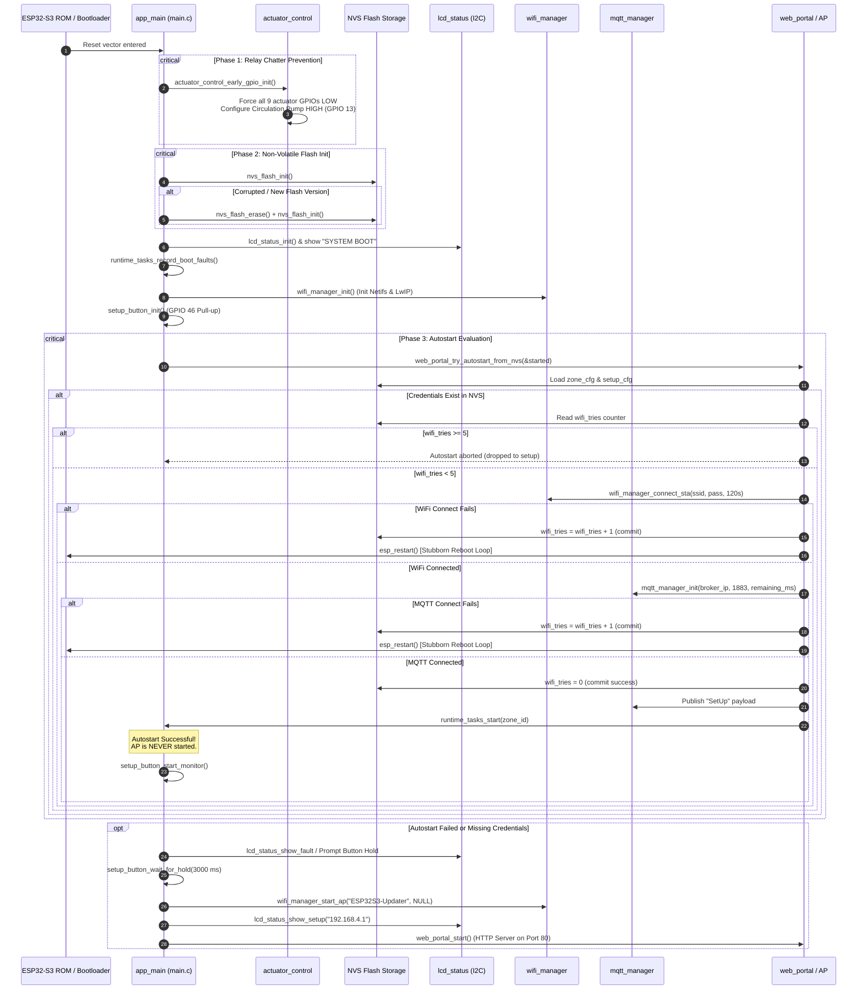
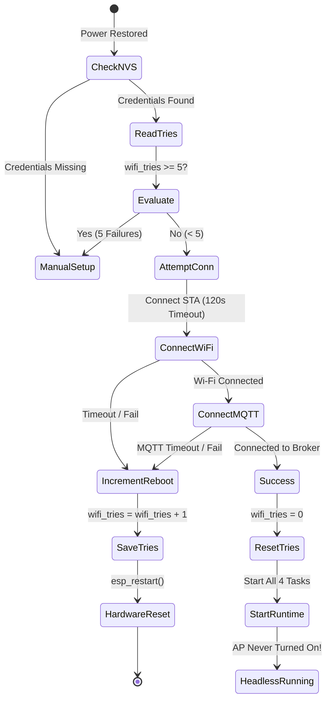

# ⚡ Boot Sequence & Headless Power Recovery

A critical requirement for unattended agricultural automation is deterministic, safe recovery after power blackouts, brownouts, or network interruptions. The **HydroponicsIDF** firmware implements a multi-phase boot sequence designed to eliminate mechanical relay chatter, verify hardware reset reasons, and autonomously rejoin the control network without human intervention.

---

## 1. Complete Boot Flowchart



---

## 2. Boot Phases in Detail

### Phase 1: Early GPIO Locking (`main.c:18`)
> [!IMPORTANT]
> When an ESP32-S3 powers up, certain GPIO pins momentarily float or enter high-impedance states before the RTOS scheduler engages. If connected to active-HIGH relay modules or MOSFET drivers, floating pins pick up electromagnetic noise and trigger **relay chatter** (rapid physical toggling of relays), which can arc electrical contacts or momentarily pump toxic concentrated chemicals.

To guarantee physical safety:
1. `actuator_control_early_gpio_init()` is executed as the **very first line** of `app_main()`.
2. All 9 actuator and relay GPIOs (`PIN_ACTUATOR_VALVE`, `PIN_ACTUATOR_PER_NUTA`, `PIN_ACTUATOR_PER_NUTB`, `PIN_ACTUATOR_PER_PH_UP`, `PIN_ACTUATOR_PER_PH_DOWN`, `PIN_RELAY_1` through `PIN_RELAY_4`) are driven **LOW** immediately.
3. The **Circulation Pump** (`PIN_CIRCULATION_PUMP`, GPIO 13) is configured as output and driven **HIGH**.

### Phase 2: NVS Initialization & Self-Healing (`main.c:20-25`)
The ESP-IDF Non-Volatile Storage (NVS) holds all critical operational parameters. If the flash partition encounters bad pages or a schema version upgrade, standard mounting fails:
```c
esp_err_t ret = nvs_flash_init();
if (ret == ESP_ERR_NVS_NO_FREE_PAGES || ret == ESP_ERR_NVS_NEW_VERSION_FOUND) {
    ESP_ERROR_CHECK(nvs_flash_erase());
    ret = nvs_flash_init();
}
ESP_ERROR_CHECK(ret);
```
This self-healing logic guarantees that a corrupted NVS does not put the MCU into an unrecoverable boot loop; it automatically re-formats the partition and prepares the node for provisioning.

### Phase 3: Hardware Reset Reason Triage (`runtime_tasks.c`)
Before starting tasks, `runtime_tasks_record_boot_faults()` interrogates the hardware reset controller via `esp_reset_reason()`:

| Reset Reason (`esp_reset_reason_t`) | Diagnosis | Firmware Reaction |
|---|---|---|
| `ESP_RST_POWERON` | Clean AC power cycle / battery connect | Normal boot; fault mask = `0x0000` |
| `ESP_RST_SW` | Software requested restart (`esp_restart()`) | Normal boot or autostart cycle |
| `ESP_RST_PANIC` | Software exception / Memory fault | Latches `SAFETY_FAULT_WDT` into boot faults |
| `ESP_RST_INT_WDT` / `ESP_RST_TASK_WDT` | Hardware or FreeRTOS Task Watchdog starved | Latches `SAFETY_FAULT_WDT` into boot faults |
| `ESP_RST_BROWNOUT` | Unstable PSU / severe voltage dip | Latches `SAFETY_FAULT_POWER` into boot faults |

Any detected crash reason is saved in `s_safety.boot_faults`. When MQTT subsequently connects, this fault is published to the broker as a retained message with QoS 1, ensuring field crashes are logged by telemetry servers.

---

## 3. The 5-Try Outage Recovery Loop (`wifi_tries`)

In commercial greenhouses, a widespread power outage causes both the ESP32 nodes and the central infrastructure (Wi-Fi access points, routers, and MQTT brokers) to lose power simultaneously.

### The Power Outage Race Condition
When power is restored:
- **ESP32-S3 boots in ~1.2 seconds**.
- **Commercial Wi-Fi routers require 60 to 90 seconds** to initialize RF radios.
- **Home Assistant / Mosquitto MQTT servers require 90 to 180 seconds** to boot.

If an IoT node gives up on its first boot attempt and immediately opens a setup access point, every node in a 50-zone greenhouse would revert to setup mode after every thunderstorm!

### The Solution: Persistent `wifi_tries` Reboot Loop
The HydroponicsIDF firmware solves this using an NVS-backed retry state machine located in `web_portal_try_autostart_from_nvs()`:



1. The device allocates a **2-minute total budget** across Wi-Fi association and MQTT connection (`120000 ms`).
2. If Wi-Fi or MQTT connection fails, the device reads `wifi_tries` from the NVS `storage` namespace, increments it by 1, and invokes `esp_restart()`.
3. The MCU performs a clean hardware reset, re-initializes all hardware registers, and tries again.
4. It will stubbornly repeat this sequence up to **5 consecutive times** (~10 minutes total window).
5. As soon as both Wi-Fi and MQTT connect successfully, `wifi_tries` is atomically reset to `0`.
6. Only if all 5 consecutive attempts fail does it abandon autostart and drop to Manual Setup Mode.

---

## 4. Manual Commissioning & Field Reconfiguration

If the device cannot connect (e.g. brand new installation or changed Wi-Fi password), it enters manual setup mode without radiating unnecessary RF signals unless explicitly requested.

### Physical Setup Button (GPIO 46)
To avoid running an unencrypted Access Point indefinitely when unattended:
1. `setup_button_wait_for_hold(3000)` blocks execution while flashing the red Fault LED (`PIN_LED_FAULT`) every 500 ms.
2. The user must **physically press and hold GPIO 46 for 3 continuous seconds**.
3. Once the 3000 ms threshold is satisfied, the firmware transitions into Soft-AP mode:
   - Starts Wi-Fi Soft-AP with SSID `ESP32S3-Updater` (Open security).
   - Writes the configuration IP (`192.168.4.1`) to the LCD display.
   - Spins up the HTTP Web Portal server on port 80.

### Background Reconfiguration Monitor (`setup_button_start_monitor`)
When Autostart succeeds, the user might still need to reconfigure the node in the field without power cycling. The firmware spawns `setup_button_monitor_task` (Priority 1, 2 KB stack):
- Continuously polls GPIO 46.
- If held for 3 seconds during live operation, it calls `runtime_tasks_stop()`, safely stops all pumps, brings up the `ESP32S3-Updater` AP, and launches the web portal.

