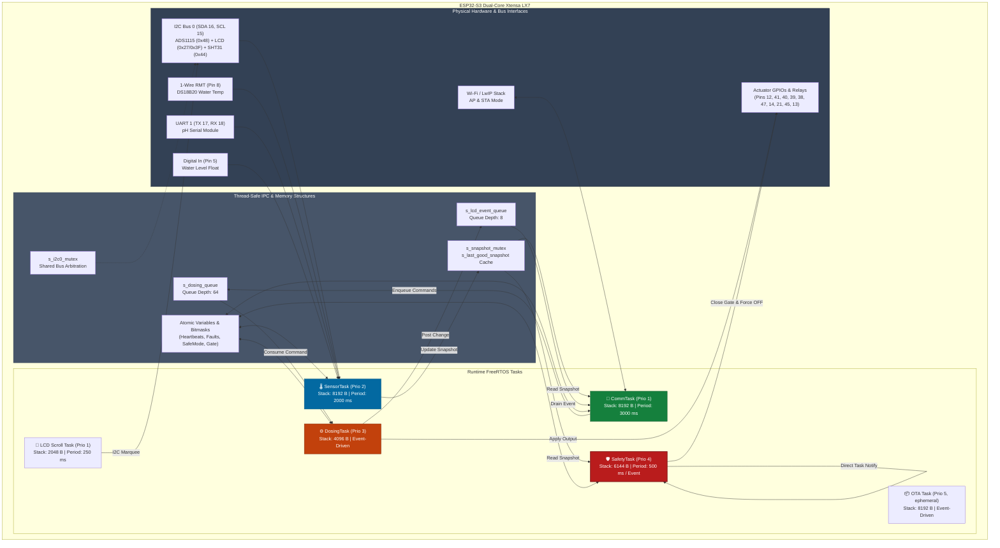
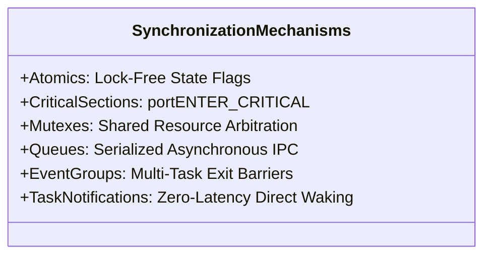

# 🏗️ System Architecture & FreeRTOS Threading Model

The **HydroponicsIDF** firmware leverages a preemptive, multi-threaded real-time architecture built on Espressif's SMP FreeRTOS implementation on the dual-core **ESP32-S3**. This document details the threading model, task scheduling, synchronization primitives, memory partitioning, and the defensive architectural designs that prevent deadlocks and priority inversions.

---

## 1. High-Level Firmware Topology



---

## 2. FreeRTOS Task Matrix

The runtime instantiates four persistent core tasks in `runtime_tasks_start()`, along with auxiliary background workers:

| Task Identifier | Priority | Stack Size (Bytes) | Interval / Trigger | Primary Source File | Primary Responsibility |
|---|:---:|:---:|:---:|---|---|
| **`SafetyTask`** (`runtime_safety_task`) | **4** (Highest) | 6,144 | 500 ms or `TaskNotify` | `runtime_safety.c` | Software/hardware watchdog supervision, sensor range checking, frozen sensor detection, dosing response timers, safe mode enforcement |
| **`DosingTask`** (`dosing_task`) | **3** | 4,096 | Event-driven (`s_dosing_queue`) | `runtime_tasks.c` | Serialized command execution, peristaltic mutual exclusion, pulse timing, channel state shadow updating |
| **`SensorTask`** (`sensor_task`) | **2** | 8,192 | 2,000 ms periodic (`vTaskDelayUntil`) | `runtime_tasks.c`, `sensor_telemetry.c` | Hardware ADC sampling (ADS1115), 1-Wire DS18B20 conversion, SHT31 environment read, rolling average filtering, snapshot updating |
| **`CommTask`** (`comm_task`) | **1** (Lowest) | 8,192 | 3,000 ms periodic (`vTaskDelayUntil`) | `runtime_tasks.c` | Snapshot acquisition & fallback, MQTT telemetry publishing, 30s version publishing, LCD event queue draining |
| **`LCD Scroll Task`** (`lcd_scroll_task_fn`) | **1** | 2,048 | 250 ms periodic | `lcd_status.c` | Asynchronous horizontal marquee scrolling of long JSON fault codes across 20x4 LCD lines 2 & 3 |
| **`OTA Task`** (`ota_http_task`) | **5** (Ephemeral) | 8,192 | Spawned on MQTT trigger | `ota_update.c` | Non-blocking HTTP firmware download, stream writing to inactive OTA app slot, validation, and reboot |
| **`Button Monitor Task`** (`setup_button_monitor_task`) | **1** | 2,048 | 50 ms polling | `setup_button.c` | Continuously monitors GPIO 46 in background after autostart; detects 3-second hold to transition to AP mode |

### Priority Rationale
1. **SafetyTask (4)** must have the highest priority in the entire system so that it can preempt any task at any time. Even if `SensorTask` or `CommTask` experiences network stalls or heavy mathematical filtering, `SafetyTask` will interrupt to check watchdog counters and shut down pumps if duration limits are exceeded.
2. **DosingTask (3)** is event-driven and controls physical actuators. It requires higher priority than sensor or comm tasks so that pump activations and deactivations occur with sub-millisecond deterministic precision without being delayed by I2C/network latency.
3. **SensorTask (2)** reads physical hardware. It operates below dosing control because a jitter of a few milliseconds in sensor reading does not endanger plant health, but it sits above communications.
4. **CommTask (1)** performs network I/O over Wi-Fi and MQTT. Network latency is fundamentally non-deterministic and can block for hundreds of milliseconds. Keeping it at priority 1 ensures network congestion never starves physical actuators or safety watchdogs.

---

## 3. Concurrency & Synchronization Primitives

The firmware strictly avoids unprotected global variables across tasks, employing a defense-in-depth hierarchy of synchronization mechanisms:



### A. Lock-Free Atomic Operations (`<stdatomic.h>`)
Used for high-frequency status flags and counters that must be updated without mutex overhead:
- `atomic_uint s_safety.dosing_heartbeat`
- `atomic_uint s_safety.sensor_heartbeat`
- `atomic_uint s_safety.comm_heartbeat`
- `atomic_uint s_safety.safety_heartbeat`
- `atomic_uint s_safety.faults` (Active fault bitmask)
- `atomic_uint s_safety.reported_faults` (Mask of faults already published to MQTT)
- `atomic_bool s_safety.safe_mode` (Emergency safe state flag)
- `atomic_bool s_override_active` (Software limit suppression flag)
- `atomic_bool s_stop_requested` (Graceful shutdown coordinator)

All atomic reads use `atomic_load()` and writes use `atomic_store()` or `atomic_fetch_or()`, ensuring memory barrier correctness across both Xtensa cores without compiler reordering.

### B. Critical Sections (`portENTER_CRITICAL`)
Used for microsecond-level atomic mutations of internal hardware states where task switching or ISR interference must be prohibited:
- `s_gate_lock`: Controls `s_gate_open`. Offers dual access paths: `portENTER_CRITICAL(&s_gate_lock)` for tasks and `portENTER_CRITICAL_ISR(&s_gate_lock)` for ISR contexts.
- `s_state_shadow_lock`: Guards the `s_channel_state_on[10]` array reflecting the logical state of all actuators.
- `s_snapshot_lock`: Guards writes and reads to the live `sensor_telemetry_snapshot_t` in `sensor_telemetry.c`.
- `s_cali_lock`: Guards in-memory `calibration_t` structs for pH and TDS.

### C. FreeRTOS Mutexes (`xSemaphoreCreateMutex`)
Used to serialize access to complex, slow, or multi-step operations:
- **`s_runtime_mutex`**: Guards runtime start/stop transitions (`runtime_tasks_start` / `runtime_tasks_stop`) with a 5000 ms timeout (`RUNTIME_MUTEX_WAIT_MS`).
- **`s_snapshot_mutex`**: Guards `s_last_good_snapshot` in `runtime_tasks.c`. `comm_task` attempts to acquire this with a 100 ms timeout to prevent indefinite blocking if the web server queries the cache.
- **`s_i2c0_mutex`** (`i2c_bus.c`): Arbitrates access to the single hardware I2C peripheral (`I2C_NUM_0`). Because ADS1115 ADC, PCF8574 LCD backpack, and GY-SHT31 all share SDA (GPIO 16) and SCL (GPIO 15), any task performing an I2C transaction MUST acquire this mutex.
- **`s_lcd_lock`** (`lcd_status.c`): Prevents screen corruption between the periodic `lcd_scroll_task_fn` and one-off screen updates (`lcd_status_show_booting`, `lcd_status_show_setup`).
- **`s_subscriptions_lock`** (`mqtt_manager.c`): Protects the 24-slot subscription registry during registration, dispatch, and resubscription loops.

### D. FreeRTOS Queues
- **`s_dosing_queue`**: Length = 64 items, item size = `sizeof(dosing_command_t)`. Decouples MQTT callbacks from actuator hardware switching.
- **`s_lcd_event_queue`**: Length = 8 items, item size = `sizeof(lcd_actuator_event_t)`. Posted by `dosing_task` upon state change; drained by `comm_task` to refresh the LCD.

### E. FreeRTOS Event Groups
- **`s_task_exit_event`**: Coordinates synchronous shutdown. Each task signals its termination by setting its bit (`TASK_EXIT_BIT_DOSING`, `TASK_EXIT_BIT_SENSOR`, `TASK_EXIT_BIT_COMM`, `TASK_EXIT_BIT_SAFETY`). `runtime_tasks_stop()` blocks on `xEventGroupWaitBits()` until all 4 tasks confirm exit.

---

## 4. Defensive Engineering & Anti-Priority-Inversion

In real-time systems, **Priority Inversion** occurs when a high-priority task is indirectly blocked by a low-priority task holding a shared resource. The HydroponicsIDF firmware incorporates specific architectural defenses against priority inversion and race conditions:

### Defense 1: LCD Decoupling from Safe Mode Entry
> [!CAUTION]
> In an earlier design, `safety_enter_safe_state()` called `lcd_status_show_emergency()`.
> Because `lcd_status_show_emergency()` acquires `s_lcd_lock` (which can be held by the Priority 1 `lcd_scroll_task_fn`), `SafetyTask` (Priority 4) was forced to wait for the scroll task to complete an I2C transaction.
> Under heavy I2C contention, this blocked `SafetyTask` long enough to miss its Task Watchdog (TWDT) reset, crashing the MCU.
>
> **The Fix (`runtime_safety.c:178`):**
> `lcd_status_show_emergency()` is strictly **prohibited** inside `safety_enter_safe_state()`. The fault code is instead queued or passed directly to `lcd_status_show_fault()` after all critical GPIOs are driven LOW.

### Defense 2: Direct GPIO LOW without Synchronous MQTT Publishes
When entering Safe Mode, all 10 actuator channels must be turned OFF immediately. 
Calling `actuator_control_apply_state()` would trigger a synchronous `mqtt_manager_publish()` for all 10 channels. If the network or Wi-Fi buffer was backpressured, `SafetyTask` would block inside LwIP network routines.

**The Fix (`runtime_safety.c:193` & `actuator_control.c:284`):**
`SafetyTask` calls `actuator_control_force_off()` directly. This modifies the hardware GPIO register and updates the internal shadow state in microseconds without touching the MQTT network stack. `comm_task` asynchronously synchronizes the MQTT broker on the next cycle via `publish_actuator_states()`.

### Defense 3: Queue Drain Loop vs. `xQueueReset` Kernel Panic
When clearing or stopping commands, calling `xQueueReset(s_dosing_queue)` while `dosing_task` is actively blocked on `xQueueReceive(s_dosing_queue, ...)` can trigger a FreeRTOS kernel panic on SMP ESP32 cores.

**The Fix (`runtime_safety.c:119`):**
The firmware replaces `xQueueReset` with an atomic non-blocking drain loop:
```c
char dummy_buffer[128];
while (xQueueReceive(queue, dummy_buffer, 0) == pdTRUE) {
    dropped_count++;
}
```

---

## 5. Memory Architecture & Partition Layout

The firmware utilizes a custom partition scheme optimized for dual OTA application slots and non-volatile calibration storage:

```
0x0000_0000 ┌──────────────────────────────────────────────────────────┐
            │ Bootloader & System ROM                                  │
0x0000_9000 ├──────────────────────────────────┬───────────────────────┤
            │ nvs (Non-Volatile Storage)       │ 16 KB (0x4000)        │
0x0000_D000 ├──────────────────────────────────┼───────────────────────┤
            │ otadata (OTA Selection State)    │ 8 KB (0x2000)         │
0x0000_F000 ├──────────────────────────────────┼───────────────────────┤
            │ phy_init (RF Calibration)        │ 4 KB (0x1000)         │
0x0001_0000 ├──────────────────────────────────┼───────────────────────┤
            │ factory (Initial Golden App)     │ 1,536 KB (0x180000)   │
0x0019_0000 ├──────────────────────────────────┼───────────────────────┤
            │ ota_0 (OTA App Slot 0)           │ 1,536 KB (0x180000)   │
0x0031_0000 ├──────────────────────────────────┼───────────────────────┤
            │ ota_1 (OTA App Slot 1)           │ 1,536 KB (0x180000)   │
0x0049_0000 └──────────────────────────────────┴───────────────────────┘
```

### Partition Functions (`partitions.csv`):
- **`nvs` (16 KB)**: Stores Wi-Fi credentials (`setup_cfg`), zone name and ID (`zone_cfg`), linear calibration coefficients (`sensor_cali`), and boot failure counter (`wifi_tries`).
- **`otadata` (8 KB)**: Maintained by `esp_ota_ops`. Stores the sequence counter determining whether `factory`, `ota_0`, or `ota_1` is booted.
- **`factory` (1.5 MB)**: Initial factory-flashed image used for baseline recovery.
- **`ota_0` & `ota_1` (1.5 MB each)**: Dual ping-pong OTA slots. Enables background downloads without taking the active application offline until validation completes.

