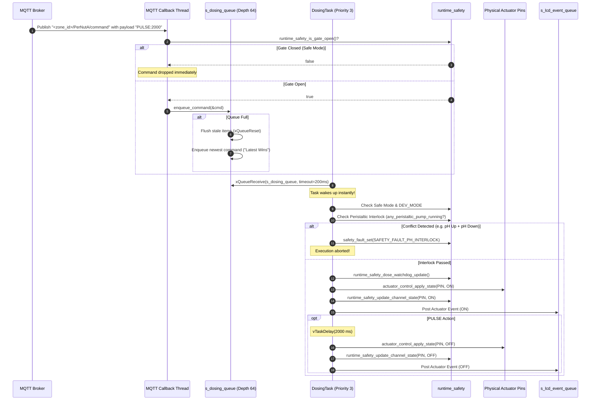

# ⚙️ Dosing & Actuator Control Subsystem

The **Dosing and Actuator Subsystem** (`actuator_control.c`, `main/runtime_tasks.c`) manages all physical power outputs on the node. It controls 5 precision dosing channels (solenoid valve + 4 peristaltic pumps), 4 generic AC/DC relays, and 1 continuously protected circulation pump. 

This subsystem is engineered to guarantee deterministic dosing durations, enforce chemical mutual exclusion, and maintain root-zone oxygenation even during catastrophic node failures.

---

## 1. Actuator Channel Matrix

The system defines 10 distinct logical channels mapped to physical ESP32-S3 GPIO outputs:

| Channel Index | Enum Identifier | Channel Name | Physical GPIO | Default Active Level | Typical Physical Load |
|:---:|---|---|:---:|:---:|---|
| **0** | `ACTUATOR_CHANNEL_VALVE` | `"valve"` | **GPIO 12** | Active HIGH | 12V DC Solenoid Freshwater Valve |
| **1** | `ACTUATOR_CHANNEL_PER_NUTA` | `"PerNutA"` | **GPIO 41** | Active HIGH | 12V DC Peristaltic Pump (Nutrient Solution A) |
| **2** | `ACTUATOR_CHANNEL_PER_NUTB` | `"PerNutB"` | **GPIO 40** | Active HIGH | 12V DC Peristaltic Pump (Nutrient Solution B) |
| **3** | `ACTUATOR_CHANNEL_PER_PH_UP` | `"PerPHUp"` | **GPIO 39** | Active HIGH | 12V DC Peristaltic Pump (pH Up / $KOH$) |
| **4** | `ACTUATOR_CHANNEL_PER_PH_DOWN` | `"PerPHDown"` | **GPIO 38** | Active HIGH | 12V DC Peristaltic Pump (pH Down / $H_3PO_4$) |
| **5** | `ACTUATOR_CHANNEL_RELAY_1` | `"relay1"` | **GPIO 47** | Active HIGH | 220V AC Main Grow Light Contactor |
| **6** | `ACTUATOR_CHANNEL_RELAY_2` | `"relay2"` | **GPIO 14** | Active HIGH | 220V AC Water Chiller / Heater |
| **7** | `ACTUATOR_CHANNEL_RELAY_3` | `"relay3"` | **GPIO 21** | Active HIGH | 12V DC Air Oxygenation Bubbler Pump |
| **8** | `ACTUATOR_CHANNEL_RELAY_4` | `"relay4"` | **GPIO 45** | Active HIGH | 12V DC Exhaust Ventilation Fan |
| **9** | `ACTUATOR_CHANNEL_CIRCULATION_PUMP` | `"CirculationPump"` | **GPIO 13** | **ALWAYS HIGH** | Submersible Water Circulation Pump |

---

## 2. The Perpetual Circulation Pump Protection Principle

In commercial hydroponics (specifically NFT and Deep Water Culture), the main water circulation pump is the life support of the crops:
- If circulation stops for as little as 30 to 60 minutes, dissolved oxygen drops to near zero.
- Plant roots drown, fungal pathogen (*Pythium*, root rot) multiplies exponentially, and total crop failure occurs.
- Even if the water chemistry goes out of balance (e.g. pH fault or sensor crash), water **must continue flowing** across the roots to prevent stagnation.

### Architectural Defense in Firmware:
The firmware treats `PIN_CIRCULATION_PUMP` (GPIO 13) as an inviolable output:
1. **Boot Initialization (`actuator_control.c:154-163`)**:
   `PIN_CIRCULATION_PUMP` is explicitly excluded from `s_gpio_list` (which drives pins LOW). Instead, it is configured independently and driven **HIGH immediately**.
2. **Ignored Command Input (`actuator_control.c:266`)**:
   ```c
   /* Circulation pump is always HIGH — ignore any attempt to drive it LOW */
   if (channel == ACTUATOR_CHANNEL_CIRCULATION_PUMP) {
       return ESP_OK;
   }
   ```
3. **Safe Mode Immunity (`actuator_control.c:299`)**:
   When `safety_enter_safe_state()` forces all outputs off via `actuator_control_force_off()`, the circulation pump is explicitly bypassed:
   ```c
   if (channel == ACTUATOR_CHANNEL_CIRCULATION_PUMP) {
       return; /* Never drive LOW */
   }
   ```
4. **De-initialization Guard (`actuator_control.c:251`)**:
   Even if the firmware tears down the actuator driver during a controlled shutdown, `PIN_CIRCULATION_PUMP` is forced HIGH.

---

## 3. Dosing Task Architecture & Event Loop

`DosingTask` runs at **Priority 3** (second highest, directly beneath `SafetyTask`) with a 4,096-byte stack budget. It is an **event-driven task** that blocks on the FreeRTOS queue `s_dosing_queue`.



### The 200 ms Timeout Loop & Watchdog Kicking
When no commands are enqueued, `DosingTask` does not sleep forever. It wakes every `DOSING_QUEUE_RECV_TIMEOUT_MS = 200` ms:
```c
if (xQueueReceive(s_dosing_queue, &cmd, pdMS_TO_TICKS(DOSING_QUEUE_RECV_TIMEOUT_MS)) != pdTRUE) {
    runtime_safety_heartbeat_dosing();
    runtime_safety_wdt_kick();
    continue;
}
```
This guarantees that even during prolonged periods of zero actuator activity, the task feeds the hardware TWDT and increments its heartbeat, proving to `SafetyTask` that its thread scheduler is healthy.

---

## 4. Command Enqueueing & "Latest-Wins" Policy

Inbound commands originate from two MQTT sources:
1. **Per-Channel Topics**: `<zone_id>/<channel_name>/command` with payloads:
   - `ON` — Turns channel continuously ON.
   - `OFF` — Turns channel OFF.
   - `PULSE:<ms>` — Energizes channel for exactly `<ms>` milliseconds, then shuts OFF automatically.
2. **Unified Zone Topic**: `<zone_id>/command` with text payload:
   - `"<channel_name> ON"`
   - `"<channel_name> OFF"`
   - `"<channel_name> PULSE <ms>"`

### Queue Overflow Management (`enqueue_command`):
If the server sends a high-frequency burst of commands that fills the 64-slot `s_dosing_queue`, standard FreeRTOS behavior would drop the newest command. For safety, this is dangerous: if the server sends 64 small dosing pulses followed by an emergency `OFF` command, the `OFF` command would be rejected!

The firmware implements a **Latest-Wins Policy**:
```c
BaseType_t sent = xQueueSend(s_dosing_queue, cmd, 0);
if (sent != pdTRUE) {
    /* Queue full — flush all stale pending commands and immediately
     * enqueue the latest one so the most recent server order takes priority. */
    UBaseType_t flushed = uxQueueMessagesWaiting(s_dosing_queue);
    xQueueReset(s_dosing_queue);
    sent = xQueueSend(s_dosing_queue, cmd, 0);
    ESP_LOGW(TAG, "Dosing queue full! Flushed %u stale commands; enqueued latest", (unsigned)flushed);
}
```

---

## 5. Chemical Interlocks & State Shadowing

To prevent data races across tasks, the hardware output state is tracked in a shadow array:
```c
static bool s_channel_state_on[ACTUATOR_CHANNEL_COUNT];
```
Protected by `s_state_shadow_lock` (`portENTER_CRITICAL`), this array provides a thread-safe source of truth:
- `runtime_safety_get_channel_state(ch)` reads the current state in constant time without accessing physical GPIO hardware registers.
- `runtime_safety_copy_channel_states(out_array)` copies all 10 channel states under a single critical section for bulk telemetry publishing.

### Peristaltic Mutual Exclusion Helper:
```c
static bool any_peristaltic_pump_running(actuator_channel_t except_channel)
{
    const actuator_channel_t per_channels[] = {
        ACTUATOR_CHANNEL_PER_NUTA,
        ACTUATOR_CHANNEL_PER_NUTB,
        ACTUATOR_CHANNEL_PER_PH_UP,
        ACTUATOR_CHANNEL_PER_PH_DOWN,
    };
    for (size_t i = 0; i < sizeof(per_channels) / sizeof(per_channels[0]); i++) {
        if (per_channels[i] == except_channel) continue;
        if (runtime_safety_get_channel_state(per_channels[i])) return true;
    }
    return false;
}
```
If Nutrient A is currently running and an MQTT message requests Nutrient B, the request is immediately rejected, protecting power supplies from current spikes and ensuring chemical dilution.

