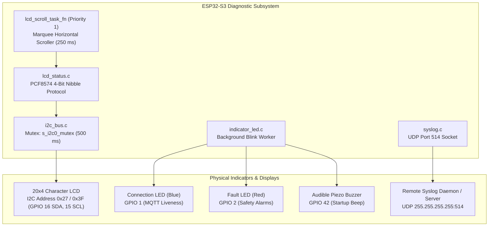

# 📟 Human-Machine Interfaces, Local Displays & Diagnostics

The **Local Interface and Diagnostics Subsystem** (`lcd_status.c`, `indicator_led.c`, `syslog.c`, `i2c_bus.c`) provides visual, audible, and network diagnostics for field technicians. It drives a 20x4 character LCD with an asynchronous text marquee scroll engine, status LEDs with non-blocking blink queues, a startup piezo buzzer, and a UDP syslog broadcast engine.

---

## 1. Visual & Local Diagnostic Topology



---

## 2. 20x4 Character LCD Subsystem (`lcd_status.c`)

The firmware drives a standard **HD44780 20x4 character LCD** interfaced via a **PCF8574 I2C I/O expander backpack** on `I2C_NUM_0`.

### Shared Bus Arbitration (`i2c_bus.c`):
Because the LCD backpack, ADS1115 ADC (pH/TDS), and GY-SHT31 (ambient) all share the same SDA (GPIO 16) and SCL (GPIO 15) lines, the legacy ESP-IDF I2C driver requires external mutual exclusion.
- Every call to `lcd_i2c_write_byte()` acquires `s_i2c0_mutex` via `i2c_bus_lock(pdMS_TO_TICKS(500))`.
- After transmitting the 4-bit nibbles and pulsing the Enable (`EN`) bit, it releases the mutex via `i2c_bus_unlock()`.

### Display Modes:
1. **Booting Screen (`lcd_status_show_booting`)**:
   ```
   ====================
       SYSTEM BOOT     
      Please wait...   
   ====================
   ```
2. **Setup Mode Screen (`lcd_status_show_setup`)**:
   ```
   -- SETUP MODE ------
   Connect WiFi then:  
   192.168.4.1         
   to configure        
   ```
3. **Emergency Stop Screen (`lcd_status_show_emergency`)**:
   ```
   !! EMERGENCY STOP !!
   !!!!!!!!!!!!!!!!!!!!
   !! EMERGENCY STOP !!
   !!!!!!!!!!!!!!!!!!!!
   ```
4. **Live Actuator Event Screen (`lcd_status_show_actuator_event`)**:
   ```
   [zone_1] NFT Lorong 
   ACT: PerNutA -> ON  
   pH: 6.12 | TDS: 840 
   EC: Normal | W: Full
   ```

---

## 3. Asynchronous Marquee Fault Scrolling Engine

Fault diagnostic payloads generated by `runtime_safety.c` are often 40 to 80 characters long (e.g. `"Water temperature out of range >1 min"` or `"Pump on-duration exceeded max"`), far exceeding the 20-character width of an LCD line.

### The Problem with Synchronous Scrolling
If a task sleeps to animate text on the LCD, it blocks its thread. If `SafetyTask` tried to animate text, it would immediately starve its own watchdog and crash the device.

### The Solution: Background Worker (`lcd_scroll_task_fn`):
When `lcd_status_show_fault(code, reason)` is invoked:
1. It copies the fault code into `s_scroll_code` and the long reason string into `s_scroll_reason` under `s_lcd_lock`.
2. If not already running, it spawns `lcd_scroll_task_fn` at **Priority 1** with a 2,048-byte stack.
3. **Circular Buffer Animation**:
   The scroll task pads the text with 4 spaces (`SCROLL_GAP = 4`), creating a contiguous circular buffer. Every `SCROLL_STEP_MS = 250` ms:
   * **Line 0**: Displays static header `!!!!!  FAULT  !!!!!`
   * **Line 1**: Displays the static Fault Code (e.g. `F-001 (Dose A)`)
   * **Line 2**: Displays a 20-character window from `offset`
   * **Line 3**: Displays the continuation window from `(offset + 20) % len`
   * Increments `offset = (offset + 1) % len`
4. **Graceful Teardown (`lcd_stop_scroll`)**:
   When faults are cleared, `s_scroll_run = false` signals the scroll task to terminate itself cleanly at the end of its cycle, avoiding sudden thread deletion while holding the I2C mutex.

---

## 4. Status Indicator LEDs & Piezo Buzzer (`indicator_led.c`)

The node provides instantaneous hardware status feedback using dedicated GPIO pins:

### A. Connection LED (`PIN_LED_CONNECTION`, GPIO 1)
- Reflects MQTT broker connectivity state.
- Driven continuously **HIGH** when `mqtt_manager_is_connected() == true`.
- Driven **LOW** immediately upon Wi-Fi or MQTT broker disconnect.

### B. Fault LED (`PIN_LED_FAULT`, GPIO 2) with Non-Blocking Blink Queue
During a safety fault, `SafetyTask` (Priority 4) cannot afford to block calling `vTaskDelay()`.
- `indicator_led_fault_blink(duration_ms)` pushes a blink request into an internal 4-slot FreeRTOS queue (`s_blink_queue`).
- A background worker (`indicator_led_task`, Priority 1) pops the request, drives GPIO 2 HIGH, sleeps for `duration_ms` using standard RTOS delays, and drives the pin LOW.
- If multiple faults trip in rapid succession, requests queue cleanly without dropping.

### C. Startup Audible Beep (`indicator_led_startup_beep`)
Upon boot, `PIN_RESERVE_BINARY` (GPIO 42) drives a 5V piezo buzzer:
- Pulses HIGH for 100 ms, LOW for 100 ms, and HIGH for 100 ms (two crisp beeps).
- Provides field personnel with immediate acoustic confirmation that the firmware booted and initialized the scheduler.

---

## 5. UDP Syslog Broadcast Engine (`syslog.c`)

To debug nodes sealed inside waterproof IP67 enclosures without opening the casing to connect a USB-to-UART cable, the firmware incorporates a remote UDP syslog engine:

- **Socket Architecture**: Initializes a standard UDP socket bound to broadcast address `255.255.255.255` on port `514`.
- **ESP-IDF Log Hook**: Injects `syslog_vprintf()` into the runtime logging framework via `esp_log_set_vprintf()`.
- **Network Broadcast**: Every call to `ESP_LOGI`, `ESP_LOGW`, or `ESP_LOGE` formats an RFC-compliant syslog datagram and broadcasts it across the local subnet. Any computer running Wireshark, `syslog-ng`, or the Antigravity IDE terminal can observe full firmware diagnostics in real-time.
- **Safety Fence**: Syslog is initialized **only after Station Wi-Fi connects** (`web_portal.c:673`), preventing UDP socket creation during the Soft-AP provisioning phase.

