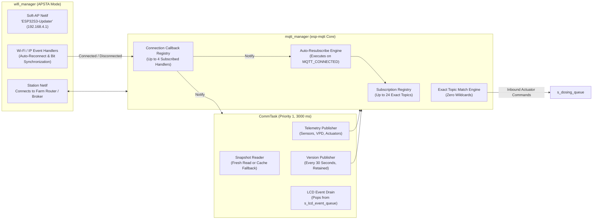

# 📡 Networking, Wi-Fi Manager & MQTT Dispatch Engine

The **Networking and MQTT Subsystem** (`mqtt_manager.c`, `wifi_manager.c`, `runtime_tasks.c`) manages all external communications for the node. It maintains station and soft-AP Wi-Fi interfaces, enforces strict exact topic dispatching without wildcards, handles telemetry caching during sensor dropouts, and automatically re-subscribes to control topics upon network recovery.

---

## 1. Network Topology & Data Flow



---

## 2. The Comm Task Lifecycle (`runtime_tasks.c`)

The communication task (`comm_task`) runs at **Priority 1** with an 8,192-byte stack. Its interval is set to `COMM_INTERVAL_MS = 3,000` ms (**3 seconds**) using `vTaskDelayUntil(&last_wake, pdMS_TO_TICKS(3000))`.

### Four-Step Cycle Execution:

1. **Firmware Version Publishing (Every 30 s)**:
   The task checks `ticks_to_ms(now - last_version_publish) >= VERSION_PUBLISH_INTERVAL_MS` (30,000 ms). It extracts the embedded semantic version string from the compiled binary via `esp_app_get_description()->version` and publishes it to `<zone_id>/version` with **QoS 1 and Retain = 1**.

2. **Snapshot Acquisition & Cache Fallback**:
   The task queries `sensor_telemetry_get_snapshot(&snap)`.
   - **Fresh Read Path**: If successful and `snap.valid == true`, it acquires `s_snapshot_mutex` (100 ms timeout) and refreshes `s_last_good_snapshot`.
   - **Transient Dropout Fallback**: If an I2C bus collision or sensor conversion temporarily fails, the task recovers `s_last_good_snapshot` from the global mutex cache. This ensures external dashboards (e.g. Node-RED or Home Assistant) do not see erratic gaps or zero-drops in telemetry charts.

3. **Sensor Telemetry Publishing**:
   Telemetry topics are transmitted sequentially. Validated sensor values are published formatted to fixed precision:
   - `<zone_id>/sensor/WaterLevel/state` -> `1` (Full) or `0` (Low)
   - `<zone_id>/sensor/WaterTemp/state` -> `24.50` (°C)
   - `<zone_id>/sensor/pH/raw` -> ADC counts (e.g. `14250`)
   - `<zone_id>/sensor/pH/state` -> `6.20` (Suppressed if `ph_valid == false`)
   - `<zone_id>/sensor/pH/valid` -> `"true"` / `"false"` (Retained = 1)
   - `<zone_id>/sensor/TDS/raw` -> ADC counts (e.g. `1840`)
   - `<zone_id>/sensor/TDS/state` -> `850.0` ppm (Suppressed if `tds_valid == false`)
   - `<zone_id>/sensor/TDS/valid` -> `"true"` / `"false"` (Retained = 1)
   - `<zone_id>/sensor/RoomTemperature/state`, `Humidity/state`, `VPD` (if SHT31 enabled)

4. **LCD Actuator Event Drain**:
   The task drains all pending items from `s_lcd_event_queue` and passes them to `lcd_status_show_actuator_event()` to update the physical display.

---

## 3. MQTT Manager Subsystem Architecture (`mqtt_manager.c`)

The MQTT manager abstracts the ESP-IDF `esp-mqtt` library, providing strict thread safety, re-entrant callback protection, and auto-recovery.

### A. Strict Exact Topic Matching (Zero Wildcards)
Many basic IoT implementations use wildcard matching (`#` or `+`). In safety-critical dosing, wildcards create catastrophic risks (e.g., a message published to `zone_1/command/all` inadvertently matching a single pump handler).

`mqtt_manager.c` strictly enforces **exact string matching**:
```c
static bool topic_matches(const char *event_topic, int event_topic_len,
                          const char *registered_topic)
{
    size_t reg_len = strlen(registered_topic);
    return (event_topic_len == (int)reg_len) &&
           (strncmp(event_topic, registered_topic, reg_len) == 0);
}
```
If an incoming message differs by even a single character, it is rejected at the dispatch layer.

### B. Anti-Deadlock Callback Snapshot Pattern
A major source of deadlocks in embedded MQTT drivers occurs when an incoming message callback attempts to call `mqtt_manager_subscribe()` or `mqtt_manager_publish()`, trying to re-acquire `s_subscriptions_lock` while the MQTT thread is already holding it.

**The Snapshot Solution (`mqtt_manager.c:140-180`):**
1. Under `s_subscriptions_lock`, `dispatch_subscribed_message()` scans the 24 subscription slots and matches the topic.
2. It copies matching function pointers and context pointers into a local stack array `snapshot[]`.
3. It **releases `s_subscriptions_lock` immediately**.
4. It iterates the stack snapshot and executes the callbacks **completely outside the lock**.
5. Callbacks are free to enqueue dosing commands, acquire other mutexes, or publish responses without any risk of deadlock.

### C. Automatic Resubscription Engine
When a Wi-Fi connection drops and reconnects:
1. `esp-mqtt` reconnects to the broker.
2. `mqtt_event_handler` intercepts `MQTT_EVENT_CONNECTED`.
3. It calls `mqtt_manager_resubscribe_all()`.
4. The function takes a snapshot of all active entries in `s_subscriptions[]` and automatically issues `esp_mqtt_client_subscribe()` for every topic, ensuring no manual resubscription logic is needed in application tasks.

---

## 4. Wi-Fi Manager Architecture (`wifi_manager.c`)

`wifi_manager` operates the ESP32-S3 Wi-Fi subsystem in **APSTA mode** (Concurrent Station + Soft-AP):

- **Power Save Disabled**: The driver explicitly executes `esp_wifi_set_ps(WIFI_PS_NONE)`. Wi-Fi power-saving modes introduce 100 ms to 300 ms packet latency, which is unacceptable for real-time actuator control.
- **Auto-Reconnect**: Outside the initial blocking connect sequence, `s_sta_auto_reconnect_enabled = true` intercepts `WIFI_EVENT_STA_DISCONNECTED` and immediately issues `esp_wifi_connect()` in the background.
- **Event Group Synchronization**: Uses `s_wifi_event_group` with `WIFI_CONNECTED_BIT` and `WIFI_FAIL_BIT` to allow application tasks to block synchronously on network state changes without polling loops.

