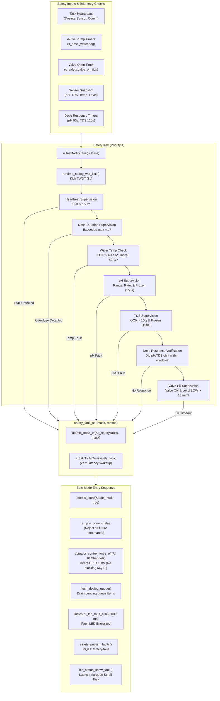

# 🛡️ Safety Subsystem, Interlocks & Watchdog Architecture

The **Safety Subsystem** (`runtime_safety.c`, `safety_config.h`) is the primary defense engine of the HydroponicsIDF firmware. In an automated chemical dosing environment, hardware glitches (frozen probes, severed cables), communication timeouts, or software deadlocks can quickly result in catastrophic crop death through overdosing acid, base, or fertilizer. 

The safety subsystem isolates faults, guarantees determinism, and executes fail-safe transitions within milliseconds.

---

## 1. Safety Subsystem Architecture Overview



---

## 2. The Two-Tier Watchdog Architecture

To protect against software lockups, task stalls, or RTOS kernel corruption, the firmware implements a layered watchdog mechanism:

### Tier 1: Hardware Task Watchdog Timer (`esp_task_wdt`)
- Configured with `SAFETY_WDT_TIMEOUT_SEC = 8` seconds and `trigger_panic = true`.
- Each runtime task registers its handle with the TWDT during initialization via `runtime_safety_wdt_register()`.
- Tasks must kick the watchdog each iteration via `runtime_safety_wdt_kick()`.
- If a task locks up in an infinite loop or blocks on an unreleased semaphore for more than 8 seconds, the hardware TWDT fires, prints a register/backtrace dump, and performs a full SoC hardware panic reboot.

### Tier 2: Software Heartbeat Supervision
Because a task might kick the hardware WDT but still fail to do useful work (e.g., stuck in an unintended fast loop), `SafetyTask` supervises internal software heartbeats:
- Each task increments an atomic counter (`atomic_fetch_add`) every loop:
  * `dosing_task` -> `runtime_safety_heartbeat_dosing()`
  * `sensor_task` -> `runtime_safety_heartbeat_sensor()`
  * `comm_task` -> `runtime_safety_heartbeat_comm()`
  * `runtime_safety_task` -> `runtime_safety_heartbeat_safety()`
- Every 500 ms, `SafetyTask` inspects `last_dosing_hb`, `last_sensor_hb`, and `last_comm_hb`.
- If any counter fails to increment for more than `SAFETY_HEARTBEAT_TIMEOUT_MS = 15000` ms (15 seconds), `SafetyTask` immediately raises `SAFETY_FAULT_WDT`, isolates the system, and enters Safe Mode.

---

## 3. Physical Protection & Safety Rules

### Rule 1: Maximum Continuous Dose Watchdogs
Peristaltic pumps must never run continuously for extended periods. Even if an MQTT disconnect prevents the server from sending an `OFF` command, the firmware local watchdog enforces a hard cutoff:

| Actuator Channel | Config Macro | Maximum Continuous On-Time | Latched Fault |
|---|---|---|---|
| Nutrient A Pump | `SAFETY_MAX_DOSE_A_MS` | **120,000 ms (2.0 min)** | `SAFETY_FAULT_DOSE_A` (`0x0001`) |
| Nutrient B Pump | `SAFETY_MAX_DOSE_B_MS` | **120,000 ms (2.0 min)** | `SAFETY_FAULT_DOSE_B` (`0x0002`) |
| pH Up Pump | `SAFETY_MAX_DOSE_PH_UP_MS` | **60,000 ms (1.0 min)** | `SAFETY_FAULT_PH_UP` (`0x0004`) |
| pH Down Pump | `SAFETY_MAX_DOSE_PH_DOWN_MS` | **60,000 ms (1.0 min)** | `SAFETY_FAULT_PH_DOWN` (`0x0008`) |

> [!NOTE]
> For `PULSE:<ms>` commands, duration validation occurs **before execution**. If a client requests `PULSE:150000` for Nutrient A, `runtime_safety_dose_watchdog_update()` rejects the command and immediately raises `SAFETY_FAULT_DOSE_A` without pulsing the GPIO.

### Rule 2: Peristaltic Mutual Exclusion & Chemical Hazard Interlock
> [!DANGER]
> Injecting concentrated acid (pH Down / $H_2SO_4$ or $H_3PO_4$) and concentrated base (pH Up / $KOH$) into the same manifold or tubing simultaneously produces an extreme exothermic neutralization reaction, gas generation, and potential manifold rupture. Furthermore, running multiple pumps simultaneously can lead to unpredictable electrical current spikes on the 12V DC power rail.

**Implementation (`dosing_task`):**
Before turning on any peristaltic channel, `any_peristaltic_pump_running(except_channel)` inspects the shadow state:
```c
if (is_peristaltic_channel(cmd.channel)) {
    if (any_peristaltic_pump_running(cmd.channel)) {
        if ((cmd.channel == ACTUATOR_CHANNEL_PER_PH_UP &&
             runtime_safety_get_channel_state(ACTUATOR_CHANNEL_PER_PH_DOWN)) ||
            (cmd.channel == ACTUATOR_CHANNEL_PER_PH_DOWN &&
             runtime_safety_get_channel_state(ACTUATOR_CHANNEL_PER_PH_UP))) {
            safety_fault_set(SAFETY_FAULT_PH_INTERLOCK, "Simultaneous pH Up and Down detected");
        }
        continue; /* Command rejected */
    }
}
```

### Rule 3: Main Water Valve Fill Timeout
To prevent reservoir overflow or flooding if a mechanical float switch fails in the LOW position or a pipe disconnects:
- When the main solenoid valve turns ON, `s_safety.valve_on_tick` records the timestamp.
- If the valve remains open and the water level sensor still reports LOW (`snap.water_level == 0`) for more than `SAFETY_FILL_TIMEOUT_MS = 600,000` ms (**10 minutes**), the system latches `SAFETY_FAULT_VALVE` (`0x0020`) and forces the valve closed.

### Rule 4: Water Temperature Range & Critical Thresholds
- **Normal Range**: `SAFETY_TEMP_LOW = 10.0°C` to `SAFETY_TEMP_HIGH = 36.0°C`.
- **Transient Filter**: If water temperature drifts outside the normal range, a fault is NOT latched immediately to avoid tripping on transient noise. It must persist continuously for `SAFETY_TEMP_OOR_FAULT_MS = 60,000` ms (1 minute).
- **Critical Threshold**: If water temperature exceeds `SAFETY_TEMP_CRITICAL = 42.0°C`, it triggers an immediate critical response.
- **Sensor Disconnect Guard**: Temperature range checks are strictly gated by `snap.water_temp_sensor_ok`. If the DS18B20 1-Wire probe is unplugged, the system does not trip spurious OOR temperature faults.

### Rule 5: pH Range, Rate of Change & Frozen Probe Checks
1. **Boot Warmup Delay**: Standard glass bulb pH electrodes require time to polarize and stabilize after power is applied. `SAFETY_PH_WARMUP_MS = 120,000` ms (**2 minutes**) suppresses pH range and frozen faults immediately following boot.
2. **Absolute Range**: Normal bounds are `4.5` to `8.5`. Exceeding these raises `SAFETY_FAULT_PH_SENSOR`.
3. **Critical Limits**: If pH drops below `4.0` (`SAFETY_PH_CRITICAL_LOW`), `SAFETY_FAULT_PH_DOWN` trips. If pH exceeds `9.0` (`SAFETY_PH_CRITICAL_HIGH`), `SAFETY_FAULT_PH_UP` trips.
4. **Rate of Change Limit**: Rapid pH shifts indicate sensor contamination or extreme overdosing. The maximum permitted rate of change is `SAFETY_PH_RATE_MAX_PER_MIN = 1.0` pH units per minute.
5. **Frozen Probe Detection**: In a large reservoir, sensor readings naturally exhibit minor thermal and chemical drift. If the pH reading remains identical ($|\Delta| < 0.005$) for `SAFETY_PH_FROZEN_SAMPLES = 300` consecutive loops (150 seconds), the firmware assumes the analog front-end or I2C ADC has hung, tripping `SAFETY_FAULT_PH_SENSOR`.

### Rule 6: Closed-Loop Dosing Response Verification
When the node dispenses chemicals, it expects the water chemistry to respond:
- **pH Dose Response**: After dosing pH Up or Down, a 90-second response deadline is armed (`SAFETY_PH_RESPONSE_TIMEOUT_MS`). The reservoir must exhibit a delta of at least `0.03` pH units in the expected direction. If the deadline expires without the required delta, `SAFETY_FAULT_PH_UP` or `SAFETY_FAULT_PH_DOWN` is latched (signaling an empty dosing bottle, clogged tubing, or uncalibrated probe).
- **TDS Dose Response**: After dispensing Nutrient A or B, a 120-second response deadline is armed (`SAFETY_TDS_RESPONSE_TIMEOUT_MS`). The reservoir must shift by at least `5.0` ppm. If it fails, `SAFETY_FAULT_DOSE_A` or `SAFETY_FAULT_DOSE_B` is latched.

---

## 4. Safe Mode Execution Mechanics

When `safety_enter_safe_state()` is triggered:

1. **Atomic Flag**: `atomic_store(&s_safety.safe_mode, true)` is set.
2. **Gate Closure**: `s_gate_open` is forced `false` under `s_gate_lock`. All subsequent calls to `enqueue_command()` from MQTT or web portal are rejected.
3. **Hardware Actuator Clamping**:
   ```c
   for (int i = 0; i < ACTUATOR_CHANNEL_COUNT; i++) {
       actuator_control_force_off((actuator_channel_t)i);
       runtime_safety_update_channel_state((actuator_channel_t)i, false);
   }
   ```
   *Note: `PIN_CIRCULATION_PUMP` (GPIO 13) is protected and stays HIGH.*
4. **Queue Flush**: All pending commands in `s_dosing_queue` are discarded using the safe non-blocking receive loop.
5. **Timer Cancellation**: Pending pH, TDS, and valve response deadlines are disarmed.
6. **Physical Alarm**: `PIN_LED_FAULT` (GPIO 2) and reserve binary are energized.
7. **Telemetry & LCD**: A JSON payload is published to `<zone_id>/safety/fault` and `lcd_status_show_fault()` launches the marquee scroll task.

---

## 5. Fault Clearing Protocol

Once the physical condition is resolved, an operator can clear the fault state via MQTT by publishing to `<zone_id>/safety/clear`:

| Payload | Action |
|---|---|
| `CLEAR` or `ALL` | Clears **all** active faults, resets boot fault latches, deactivates Safe Mode, and re-opens the command gate (`s_gate_open = true`). |
| `MASK:<hex>` | Clears only the specific fault bits defined in the hexadecimal mask (e.g. `MASK:0x0080` to clear TDS fault). If other faults remain, Safe Mode stays active. |

### Operational Override Mode (`<zone_id>/override`)
For maintenance and probe calibration, operators can publish `ON` to `<zone_id>/override`. This sets `s_override_active = true`, which temporarily suppresses software limits (max continuous dosing timers, out-of-range sensor trips, and dose response deadlines) without disabling the physical interlock between pH Up and Down.

