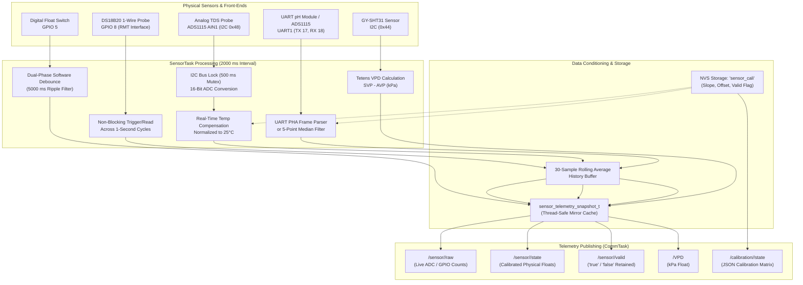

# 🌡️ Sensor Telemetry, Signal Processing & Calibration

The **Sensor Subsystem** (`sensor_telemetry.c`, `sensor_calibration_nvs.c`) is responsible for acquiring physical environmental data from a heterogeneous suite of analog and digital sensors. It converts raw electrical readings into validated agronomic telemetry, applies moving average noise suppression, compensates for real-time temperature fluctuations, and manages two-point linear calibrations stored in non-volatile flash.

---

## 1. Sensor Pipeline Architecture



---

## 2. Sensor Acquisition Details

### A. Digital Water Level (Dual-Phase Debounce Filter)
Water tanks experience continuous ripples, wave action from pump returns, and electrical transients that can cause mechanical float switches to bounce rapidly between HIGH (1) and LOW (0).

**Debounce State Machine (`sensor_telemetry.c:261-328`):**
- **HIGH (1) [Tank Full]**: Committed **immediately**. Cancels any pending LOW debounce timer.
- **LOW (0) [Tank Empty]**:
  * **Stable LOW**: If the preceding HIGH state lasted longer than `WATER_LEVEL_BOUNCE_WINDOW_MS = 200` ms, the level is assumed stable and commits LOW immediately.
  * **Bouncy LOW**: If the preceding HIGH lasted $\le 200$ ms, a software `esp_timer` (`s_wl_debounce_timer`) is armed for `WATER_LEVEL_DEBOUNCE_LOW_MS = 5,000` ms (**5 seconds**). The system continues reporting HIGH until the timer completes without the float returning HIGH.

### B. Water Temperature (DS18B20 1-Wire Driver)
A 12-bit DS18B20 conversion requires **750 milliseconds**. Blocking a FreeRTOS task for 750 ms wastes CPU cycles and disrupts task timing.

**Non-Blocking Split-Cycle Pattern:**
1. **At the start of loop ($T = 0$)**: The task calls `sample_water_temp()`, which reads the conversion result initiated during the previous cycle.
2. **At the end of loop ($T = 50\text{ ms}$)**: The task calls `ow_trigger_conversion()`, starting the 750 ms conversion in hardware.
3. The task delays until the next cycle ($T = 2000\text{ ms}$), by which time the temperature reading is long finished and ready in the scratchpad.

**Self-Healing 1-Wire Recovery (`ow_reinit`):**
- If 1-Wire read errors reach `OW_REINIT_AFTER_N_FAILURES = 5`, the RMT bus is torn down and re-enumerated.
- If the probe is completely dead for `SENSOR_TEMP_FAIL_THRESHOLD = 100` consecutive samples (~200 seconds), an automatic recovery reinitialization is executed every `OW_DEAD_RETRY_INTERVAL = 15` samples to recover from hardware power glitches without a system reboot.

### C. TDS Sensor (Real-Time Temperature Compensation)
Total Dissolved Solids (TDS) probes measure electrical conductivity (EC), which increases by approximately **2.0% per degree Celsius** increase in water temperature. To obtain an accurate nutrient concentration, the reading must be normalized to standard **25.0°C**:

$$\text{TDS}_{\text{coeff}} = 1.0 + 0.02 \times (T_{\text{water}} - 25.0)$$

$$\text{Raw}_{\text{compensated}} = \frac{\text{Raw}_{\text{ADC}}}{\text{TDS}_{\text{coeff}}}$$

$$\text{TDS}_{\text{ppm}} = \text{Slope} \times \text{Raw}_{\text{compensated}} + \text{Offset}$$

*Note: If the temperature sensor is disconnected or invalid, the compensation coefficient falls back safely to $1.0$ ($T = 25.0^\circ\text{C}$). The result is clamped to $[0.0, 5000.0]\text{ ppm}$.*

### D. pH Sensor (Dual-Source Interface)
The firmware supports both UART intelligent modules and raw analog ADC probes, selectable via `PH_SOURCE_USE_SERIAL` in `pin_config.h`:
- **Mode 1: Serial UART Module (`PH_SOURCE_USE_SERIAL == 1`)**:
  Connects to hardware `UART_NUM_1` (TX GPIO 17, RX GPIO 18 @ 115,200 baud). Listens for frame format:
  ```
  [ 'P' ] [ 'H' ] [ 'A' ] [ High Byte ] [ Low Byte ]
  ```
  Decodes the 16-bit payload as raw counts and applies calibration coefficients to produce physical pH [0.0 – 14.0].
- **Mode 2: ADS1115 Analog ADC (`PH_SOURCE_USE_SERIAL == 2`)**:
  Samples ADS1115 channel AIN1. To reject switching noise from peristaltic motors and inductive pump coils, it takes **5 consecutive samples** and computes the **Median Filtered ADC Count** using an in-place insertion sort before applying the linear equation.

### E. Ambient Environment & Vapor Pressure Deficit (VPD)
Using the Sensirion **GY-SHT31** digital sensor over I2C (Address `0x44`), the firmware acquires room temperature ($T_{\text{room}}$ in °C) and Relative Humidity ($RH$ in %).

Vapor Pressure Deficit (VPD) indicates the transpiration drying power of the atmosphere on crop leaves. The firmware computes VPD in real-time using the **Tetens equation**:

1. **Saturated Vapor Pressure ($SVP$) in kPa:**
   $$SVP = 0.61078 \times \exp\left(\frac{17.27 \times T_{\text{room}}}{T_{\text{room}} + 237.3}\right)$$

2. **Actual Vapor Pressure ($AVP$) in kPa:**
   $$AVP = SVP \times \left(\frac{RH}{100.0}\right)$$

3. **Vapor Pressure Deficit ($VPD$):**
   $$VPD = SVP - AVP$$

---

## 3. Dynamic Two-Point Linear Calibration Protocol

Hydroponic sensors drift over time and require routine recalibration. Instead of requiring firmware recompilation, the system supports dynamic two-point linear calibration over MQTT.

### Calibration Request (`<zone_id>/calibration/<pH|TDS>/set`):
The server transmits two reference calibration points:
```json
{
  "actual_1": 4.01,
  "raw_1": 16250.0,
  "actual_2": 6.86,
  "raw_2": 12100.0,
  "updated_at": 1729864200
}
```

### Firmware Mathematical Solver:
The firmware verifies that all numbers are finite, checks that $\text{raw}_1 \neq \text{raw}_2$, and computes:

$$\text{Slope} = \frac{\text{actual}_2 - \text{actual}_1}{\text{raw}_2 - \text{raw}_1}$$

$$\text{Offset} = \text{actual}_1 - (\text{Slope} \times \text{raw}_1)$$

### Plausible Range Validation:
Before writing to flash, the coefficients are verified against hardware sanity limits:
- **pH Limits**: Slope $[-20.0, 20.0]$, Offset $[-50.0, 50.0]$.
- **TDS Limits**: Slope $[-100.0, 100.0]$, Offset $[-500.0, 500.0]$.

### NVS Storage & Verification Loop (`sensor_calibration_nvs.c`):
1. **Write**: The new coefficients are saved to the `sensor_cali` NVS namespace.
2. **Retry**: If the write fails, up to 2 additional attempts are made.
3. **Readback Verification**: The firmware reads the values back from flash and confirms exact equality with memory (`expected_slope == loaded_slope`).
4. **Publish Confirmation**: Upon successful verification, the firmware publishes the active calibration status to `<zone_id>/calibration/<pH|TDS>/state` (Retained, QoS 1):
   ```json
   {
     "mode": "linear",
     "slope": -0.0006867,
     "offset": 15.168,
     "valid": true,
     "updated_at": 1729864200
   }
   ```

