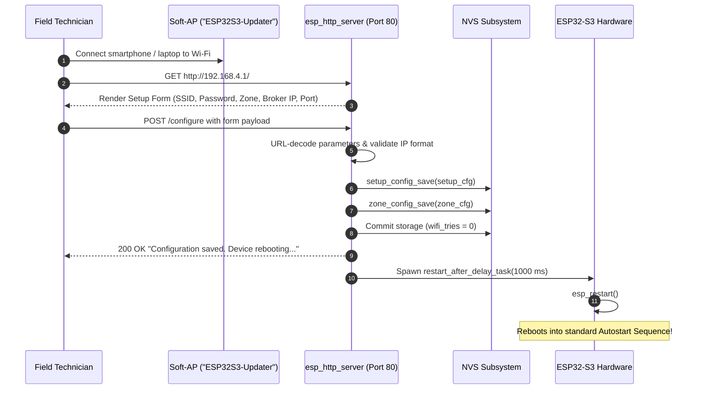
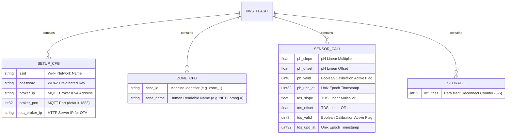
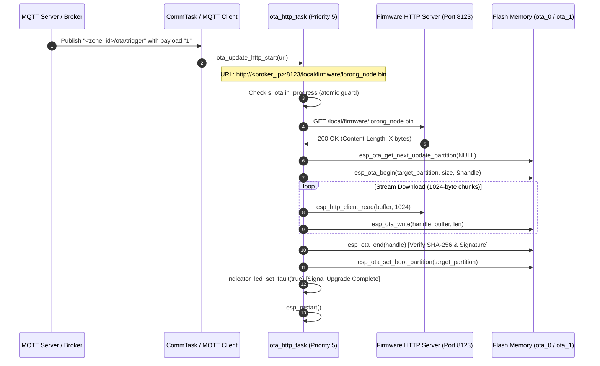

# 📦 Web Portal, Over-The-Air (OTA) Updates & Commissioning

The **Commissioning and Maintenance Subsystem** (`web_portal.c`, `ota_update.c`, `setup_button.c`, `setup_config.c`, `zone_config.c`) provides headless configuration, physical button overrides, and non-blocking remote firmware updates over standard HTTP.

---

## 1. Web Portal & Commissioning Architecture

When a device is first unboxed or fails to connect to its saved Wi-Fi/MQTT credentials, it exposes an embedded HTTP web server on local port 80.

### HTTP Endpoints (`web_portal.c`):
- **`GET /`** (`root_get_handler`):
  Serves an HTML5/CSS configuration page showing the current active Zone ID and input fields for:
  * **Wi-Fi SSID** (Max 32 characters, required)
  * **Wi-Fi Password** (Max 63 characters, optional)
  * **New Zone ID** (e.g. `zone_1`, optional reassignment)
  * **New Zone Name** (e.g. `Lorong NFT A`, optional reassignment)
  * **MQTT Broker IP** (Numeric IPv4 required, e.g. `192.168.1.50`; hostnames like `.local` are rejected because mDNS resolution is disabled during early boot)
  * **MQTT Broker Port** (Default `1883`)
- **`POST /configure`** (`configure_post_handler`):
  Parses the URL-encoded payload (`url_decode()`), validates field lengths, saves the records to the `setup_cfg` and `zone_cfg` NVS namespaces, and launches `restart_after_delay_task` to perform a clean hardware reset after 1 second.

---

## 2. Physical Setup Button Subsystem (`setup_button.c`)

Field nodes run completely headless without keyboards or touchscreens. To prevent unauthorized Wi-Fi access while still enabling field reconfiguration, the firmware utilizes a single tactile button on **GPIO 46** configured as an active-LOW input with an internal pull-up resistor.

### State 1: Boot Wait Mode (`setup_button_wait_for_hold`):
If Autostart fails (or on initial unboxing), the device halts in `setup_button_wait_for_hold(3000)`:
- The red Fault LED (`PIN_LED_FAULT`, GPIO 2) flashes at 2 Hz (500 ms ON / 500 ms OFF) to signal "waiting for operator".
- The user must **press and hold GPIO 46 for 3 continuous seconds**.
- Short presses (< 3000 ms) are ignored, resetting the debounce counter.
- Once 3 seconds elapse, the LED turns off and the device transitions to Soft-AP mode.

### State 2: Runtime Reconfiguration Monitor (`setup_button_start_monitor`):
When Autostart succeeds, `setup_button_start_monitor()` spawns a lightweight FreeRTOS worker (`setup_button_monitor_task`, Priority 1, 2 KB stack):
- Polls GPIO 46 every 50 ms.
- If an operator presses and holds the button for 3 seconds during live production:
  1. `runtime_tasks_stop()` is called (all pumps and relays are immediately shut down).
  2. Wi-Fi Soft-AP `ESP32S3-Updater` is started.
  3. The web portal server is launched on `192.168.4.1`.
  4. The monitor task deletes itself.

---

## 3. Non-Volatile Storage (NVS) Schema

The firmware organizes configuration across 4 independent NVS namespaces:

---

## 4. HTTP Over-The-Air (OTA) Firmware Updates (`ota_update.c`)

The firmware implements an asynchronous, background HTTP OTA upgrade mechanism capable of updating the application binary in the field without taking sensor acquisition offline during the download phase.

### OTA Update Flow:

### Safety Features of the OTA Engine:
1. **Concurrency Protection**: An atomic variable `s_ota.in_progress` prevents multiple OTA triggers from colliding. If an OTA is already downloading, duplicate requests return `ESP_ERR_INVALID_STATE`.
2. **Buffer Stream Chunking**: Downloads are processed in 1,024-byte chunks (`OTA_HTTP_BUFFER_SIZE`), requiring minimal RAM overhead and allowing the 8,192-byte OTA task stack to operate safely.
3. **Total Size Boundary Enforcement**: The maximum permitted binary size is clamped to `OTA_MAX_TOTAL_SIZE = 4 MB` (4,194,304 bytes). If `Content-Length` or cumulative downloaded bytes exceed this limit, the download is immediately aborted with `ESP_ERR_INVALID_SIZE`, preventing flash overflow.
4. **Partition Integrity Verification**: `esp_ota_end()` checks the image header, magic bytes, and SHA-256 checksum against the compiled application description. If verification fails, the update partition is aborted and the active app remains untouched.
5. **Rollback Protection**: The new image is written to the inactive slot (`ota_0` or `ota_1`). If the new binary crashes during its initial boot, the ESP-IDF bootloader automatically falls back to the previous stable slot.

