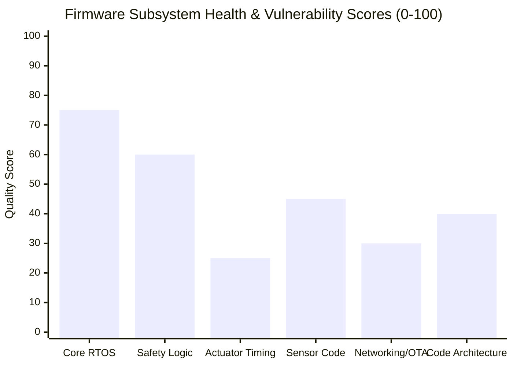

# 🔍 Firmware Audit: Executive Summary & Risk Matrix

This document provides a comprehensive, adversarial, and uncompromising engineering audit of the **HydroponicsIDF** firmware. While the firmware displays advanced FreeRTOS design patterns (such as layered watchdogs, atomic flags, and early boot clamping), an in-depth codebase audit reveals **severe physical safety vulnerabilities, race conditions, architectural spaghetti code, and glaring cybersecurity oversights**.

If deployed in a high-consequence commercial farming facility without remediation, these flaws can lead to **uncontrolled chemical dumping, hardware panic reboots during dosing, flash memory burnout, and remote firmware hijacking**.

---

## 1. Overall Codebase Health Scorecard

| Subsystem / Dimension | Score | Status | Primary Finding |
|---|:---:|:---:|---|
| **Core RTOS & Concurrency** | **75 / 100** | ⚠️ Acceptable | Solid use of atomics and priorities, but marred by an SMP `xQueueReset` race condition. |
| **Safety & Interlock Engine** | **60 / 100** | ⚠️ At Risk | Thoughtful software thresholds, but lacks physical hardware relay interlocks and has bypassable response checks. |
| **Actuator & Dosing Timing** | **25 / 100** | 🚨 **CRITICAL** | Synchronous 60-second blocking `vTaskDelay` triggers Task Watchdog panic resets and ignores Emergency Stop commands. |
| **Sensor Telemetry Pipeline** | **45 / 100** | ⚠️ Degraded | 1,870-line monolithic God-file; fragile string-searching JSON parsing; uncalibrated raw fallback risks. |
| **Networking, OTA & Security** | **30 / 100** | 🚨 **CRITICAL** | Plaintext unauthenticated HTTP OTA allows remote code execution (RCE); unencrypted MQTT & open Wi-Fi AP. |
| **Code Modularity & Cleanliness**| **40 / 100** | ⚠️ Spaghetti | Single Responsibility Principle (SRP) violations; hardcoded magic numbers; pin definition discrepancies across files. |

---

## 2. Master Vulnerability & Risk Matrix

Issues are categorized by severity according to industrial embedded safety standards (IEC 61508 / ISO 13849):

| ID | Category | Severity | File & Location | Vulnerability Summary | Real-World Failure Consequence |
|:---:|---|:---:|---|---|---|
| **VULN-01** | **Safety / RTOS** | 🔴 **CRITICAL** | `actuator_control.c:321` `runtime_tasks.c:800` | Synchronous `vTaskDelay(pulse_ms)` inside `dosing_task` blocks task up to 60s without kicking TWDT. | **MCU Panic Reset & Pump Freezing**: Pulses > 8s trip the 8-second TWDT, causing sudden reboot. Emergency Stop cannot be processed during a pulse. |
| **VULN-02** | **Concurrency** | 🔴 **CRITICAL** | `runtime_tasks.c:451` `runtime_safety.c:119` | `xQueueReset(s_dosing_queue)` called while `dosing_task` is blocked on `xQueueReceive`. | **Kernel Panic / Memory Corruption**: Triggers FreeRTOS SMP assertion panic during high-frequency MQTT command bursts. |
| **VULN-03** | **Cybersecurity** | 🔴 **CRITICAL** | `ota_update.c:43-150` | Unsigned, unencrypted HTTP OTA firmware download on hardcoded port 8123 without crypto verification. | **Remote Firmware Takeover / RCE**: An attacker on the LAN can spoof the binary and gain full root control over physical high-voltage relays. |
| **VULN-04** | **Hardware / Safety**| 🟠 **HIGH** | `pin_config.h:24-25` `runtime_tasks.c:771` | Chemical hazard interlock (pH Up vs Down) is enforced **solely in software**; no hardware electrical interlock. | **Chemical Manifold Rupture**: Microcontroller crash, memory bitflip, or stuck relay contact causes simultaneous acid/base injection. |
| **VULN-05** | **Architecture** | 🟠 **HIGH** | `sensor_telemetry.c` | **1,870-line monolithic file** combining 4 physical sensor drivers, NVS, MQTT subscriptions, and JSON parsing. | **Maintainability Nightmare**: Extreme coupling; modifying TDS filtering risks breaking 1-Wire temperature timing or NVS state. |
| **VULN-06** | **Reliability** | 🟠 **HIGH** | `sensor_telemetry.c:1055` | Fragile hand-rolled `json_get_float()` string searching instead of industrial `cJSON` parser. | **Calibration Failure**: Fails if JSON contains whitespace around colons (e.g. `"actual_1" : 4.0`), corrupting calibration. |
| **VULN-07** | **Configuration** | 🟡 **MEDIUM** | `pin_config.h:63` `setup_button.c:8` | Pin definition mismatch: `PIN_SETUP_BUTTON` defined as GPIO 6 in header, but hardcoded as GPIO 46 in `.c` files. | **Hardware Configuration Bug**: Modifying header pin definitions has zero effect on firmware; deceptive and dangerous for board revisions. |
| **VULN-08** | **Cybersecurity** | 🟡 **MEDIUM** | `web_portal.c:137` `mqtt_manager.c:11` | Wi-Fi Soft-AP is unencrypted (`WIFI_AUTH_OPEN`); Web portal has no authentication or CSRF tokens; MQTT on unencrypted port 1883. | **Unauthorized Reconfiguration**: Anyone nearby can connect to `ESP32S3-Updater` and hijack Wi-Fi credentials or zone IDs. |
| **VULN-09** | **Hardware Life** | 🟡 **MEDIUM** | `web_portal.c:663` `sensor_telemetry.c:1240`| Un-rate-limited NVS writes on reboot loops (`wifi_tries`) and calibration topics. | **Flash Memory Burnout**: Repeated reboot cycles or an MQTT message flood will exhaust SPI flash write endurance (100k cycles). |
| **VULN-10** | **Network / Syslog**| 🟢 **LOW** | `syslog.c:30` | Hardcoded broadcast IP `255.255.255.255:514` floods local subnets and leaks internal state over plaintext UDP. | **Broadcast Storms & Info Leak**: Blocked by enterprise routers; leaks sensitive node status to all network hosts. |

---

## 3. Detailed Audit Chapter Guide

This audit directory is organized into dedicated technical investigations:

- **[[01 - Critical Safety Vulnerabilities & Timing Hazards]]**: Deep dive into the 60-second blocking pulse trap, the `xQueueReset` kernel race condition, and the lack of physical relay interlocks.
- **[[02 - Spaghetti Architecture & Code Smells]]**: Line-by-line breakdown of the 1,870-line `sensor_telemetry.c` God-file, hand-rolled string-searching JSON parser bugs, and pin definition discrepancies.
- **[[03 - Networking, OTA & Cybersecurity Audit]]**: Analysis of unsigned HTTP OTA firmware updates, unauthenticated captive web portals, unencrypted MQTT telemetry, and flash wear-out vectors.
- **[[04 - Sensor & Actuator Physics Critique]]**: Critique of sensor signal-to-noise assumptions, 2-point linear interpolation limitations at extreme pH/EC, and circulation pump dry-run risks.
- **[[05 - Refactoring Roadmap & Remediation Plan]]**: Actionable, production-ready C code replacements and structural refactoring designs to eliminate every vulnerability.

