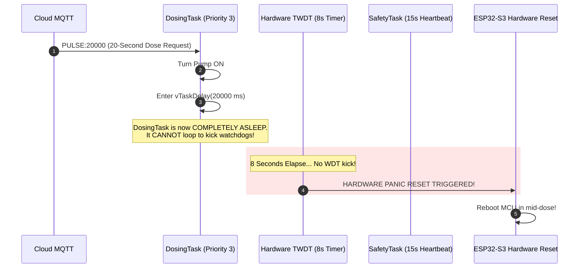

# 🚨 Critical Safety Vulnerabilities & Real-Time Timing Hazards

This chapter investigates the high-severity architectural flaws and timing traps discovered in the HydroponicsIDF firmware. These defects directly undermine the safety-critical guarantees of the system, creating conditions where the node can lock up, panic reboot during chemical injection, or fail to respond to emergency stop commands.

---

## 1. VULN-01: The 60-Second Synchronous Pulse Trap (Watchdog Panic)

### Severity: 🔴 CRITICAL
**Source Locations:**
- `main/actuator_control.c` (Lines 310–323)
- `main/runtime_tasks.c` (Lines 798–802)
- `main/safety_config.h` (Lines 20 & 31–34)

### Vulnerability Mechanism
The firmware allows clients to issue `PULSE:<ms>` commands for up to 60,000 milliseconds (`ACTUATOR_MAX_PULSE_MS = 60000U`). When `dosing_task` receives this command, it invokes `actuator_control_apply_pulse()`:

```c
// actuator_control.c:310-323
esp_err_t actuator_control_apply_pulse(actuator_channel_t channel, uint32_t pulse_ms)
{
    if (pulse_ms == 0 || pulse_ms > ACTUATOR_MAX_PULSE_MS) {
        return ESP_ERR_INVALID_ARG;
    }

    esp_err_t ret = actuator_control_apply_state(channel, true);
    if (ret != ESP_OK) {
        return ret;
    }

    vTaskDelay(pdMS_TO_TICKS(pulse_ms));  // <--- BLOCKING EXECUTION HERE!
    return actuator_control_apply_state(channel, false);
}
```

### The Fatal Timing Contradiction
Compare the timing parameters defined across the codebase:
- `ACTUATOR_MAX_PULSE_MS` = **60,000 ms (60 seconds)**
- `SAFETY_WDT_TIMEOUT_SEC` = **8 seconds** (`esp_task_wdt` hardware timeout)
- `SAFETY_HEARTBEAT_TIMEOUT_MS` = **15,000 ms (15 seconds)** (`SafetyTask` software watchdog)



### Consequences:
1. **Guaranteed System Panic Reboot**: Any pulse longer than 8,000 ms (e.g. 10,000 ms or 20,000 ms) forces `dosing_task` into a sleep state where it **cannot feed the hardware Task Watchdog Timer**. At exactly $T = 8.001$ seconds, the ESP-IDF TWDT fires a panic reset, crashing the node in the middle of dosing!
2. **Heartbeat Fault Latch**: Even if the hardware WDT is disabled, at $T = 15.001$ seconds, `SafetyTask` detects that `s_safety.dosing_heartbeat` has stalled and raises `SAFETY_FAULT_WDT`, tripping Safe Mode and logging an erroneous software hang.
3. **Emergency Stop Deafness**: While `dosing_task` is blocked in `vTaskDelay()`, it **cannot process any new commands** from `s_dosing_queue`. If a pipe bursts or an operator presses an emergency stop button in Node-RED, the emergency `OFF` command sits unread in the queue while the pump continues to run until the delay expires or the MCU crashes!
4. **Channel Starvation**: Relays and other actuators cannot be toggled while a single pump is pulsing.

---

## 2. VULN-02: The `xQueueReset` SMP Kernel Panic Race Condition

### Severity: 🔴 CRITICAL
**Source Locations:**
- `main/runtime_tasks.c` (Lines 442–453)
- `main/runtime_safety.c` (Lines 111–131)

### Vulnerability Mechanism
In `runtime_safety.c`, the author was clearly aware of a known FreeRTOS multi-core race condition, explicitly writing:
```c
// runtime_safety.c:118-124
static void flush_dosing_queue(const char *reason)
{
    /* Draining queue safely without xQueueReset to prevent Kernel Panic
     * if dosing_task is currently blocked on xQueueReceive. */
    char dummy_buffer[128];
    while (xQueueReceive(queue, dummy_buffer, 0) == pdTRUE) {
        dropped_count++;
    }
}
```

**Yet in `runtime_tasks.c:451`, the developer violated their own rule:**
```c
// runtime_tasks.c:442-453
static bool enqueue_command(const dosing_command_t *cmd, const char *source)
{
    // ...
    BaseType_t sent = xQueueSend(s_dosing_queue, cmd, 0);

    if (sent != pdTRUE) {
        /* Queue full — flush all stale pending commands and immediately
         * enqueue the latest one so the most recent server order takes priority. */
        UBaseType_t flushed = uxQueueMessagesWaiting(s_dosing_queue);
        xQueueReset(s_dosing_queue);  // <--- DEADLY RACE CONDITION ON DUAL-CORE SMP!
        sent = xQueueSend(s_dosing_queue, cmd, 0);
    }
    return (sent == pdTRUE);
}
```

### The SMP FreeRTOS Danger:
1. `enqueue_command()` executes within the **MQTT Callback Thread** (typically running on **Core 0** inside the LwIP network task).
2. `dosing_task` executes on **Core 1** and is actively blocked in `xQueueReceive(s_dosing_queue, &cmd, 200ms)`.
3. According to official FreeRTOS architecture rules: **`xQueueReset()` must NEVER be called on a queue while another task or core is actively blocked waiting on it.**
4. When `xQueueReset()` resets queue pointers while Core 1 is evaluating `xTasksWaitingToReceive`, the internal FreeRTOS event list pointers are corrupted, triggering an `assert failed: xQueueGenericReset` kernel panic or a fatal memory fault (`LoadProhibited`).

---

## 3. VULN-04: Pure Software Chemical Interlock (Single Point of Failure)

### Severity: 🟠 HIGH
**Source Locations:**
- `main/pin_config.h` (Lines 24–25)
- `main/runtime_tasks.c` (Lines 765–775)

### Vulnerability Mechanism
The chemical safety rule preventing concentrated acid ($H_3PO_4$ pH Down) and concentrated base ($KOH$ pH Up) from running simultaneously is implemented **exclusively in application C code**:

```c
bool ph_chemical_conflict =
    (cmd.channel == ACTUATOR_CHANNEL_PER_PH_UP &&
     runtime_safety_get_channel_state(ACTUATOR_CHANNEL_PER_PH_DOWN)) ||
    (cmd.channel == ACTUATOR_CHANNEL_PER_PH_DOWN &&
     runtime_safety_get_channel_state(ACTUATOR_CHANNEL_PER_PH_UP));

if (ph_chemical_conflict) {
    runtime_safety_fault_set(SAFETY_FAULT_PH_INTERLOCK, "Simultaneous pH Up and Down detected");
    continue;
}
```

### Why Software-Only Interlocks Fail Industrial Standards:
In functional safety standards (IEC 61508 / SIL-2 and ISO 13849):
> *"A catastrophic chemical hazard must never depend solely on a single uncertified microcontroller executing application software."*

**Failure Modes:**
1. **Microcontroller Freeze in HIGH State**: If the MCU core crashes or enters a hardware lockup while driving GPIO 39 HIGH, the software interlock ceases to execute. If a mechanical relay driver has floating inputs, both pumps can run simultaneously.
2. **Relay Contact Welding**: Cheap mechanical relay modules frequently weld their contacts closed due to inductive arcing when switching DC pump motors. The microcontroller might output logic LOW, but the physical contacts remain mechanically welded HIGH. The software has no feedback contacts (auxiliary contact monitoring) to verify physical relay position!
3. **Memory Bitflip (Single Event Upset)**: A cosmic ray or electrical noise spike flipping a single bit in the `s_channel_state_on[]` array bypasses the software check entirely.

### Electrical Remediation:
A hardware **break-before-make electromechanical interlock** must be implemented using relay wiring:
```
+12V DC Supply ──► [Relay 1: pH Up COM]
                      ├── NO Contact ──► pH Up Pump Motor (+)
                      └── NC Contact ──► [Relay 2: pH Down COM]
                                            └── NO Contact ──► pH Down Pump Motor (+)
```
*In this electrical topology, it is physically impossible for the pH Down pump to receive power while the pH Up relay coil is energized, even if both MCU GPIOs are shorted to 3.3V!*

---

## 4. Priority Inversion & Cascade Latencies on Shared I2C0 Bus

### Severity: 🟡 MEDIUM
**Source Locations:**
- `main/i2c_bus.c` (Lines 48–55)
- `main/lcd_status.c` (Lines 39–53 & 360)
- `main/sensor_telemetry.c` (Lines 587, 645, 674)

### Vulnerability Mechanism
Three distinct peripherals share `I2C_NUM_0` on GPIO 16 (SDA) and GPIO 15 (SCL):
1. **PCF8574 LCD Backpack** (`lcd_status.c`)
2. **ADS1115 16-Bit ADC** (`sensor_telemetry.c`)
3. **GY-SHT31 Ambient Sensor** (`sht31.c`)

The bus is arbitrated using a standard FreeRTOS mutex `s_i2c0_mutex` with a **500 ms timeout** (`pdMS_TO_TICKS(500)`).

### The Contention Cascade:
1. `lcd_scroll_task_fn` runs at **Priority 1** (lowest). When updating lines 2 and 3 of the 20x4 LCD, it issues dozens of 4-bit nibble writes to the PCF8574. Each byte involves bit-banging delays (`esp_rom_delay_us(50)`).
2. During this extended transfer, `lcd_scroll_task_fn` holds `s_i2c0_mutex`.
3. `SensorTask` (**Priority 2**) wakes up to take an ADS1115 reading. It calls `i2c_bus_lock(500ms)`.
4. While FreeRTOS has priority inheritance for mutexes (elevating the scroll task's priority to 2), the LCD transfer must still physically complete over the slow 100 kHz bus.
5. If the LCD backpack drops an ACK or stretches the clock, `SensorTask` blocks for up to **500 ms**.
6. Inside `SensorTask`, there are multiple I2C reads per cycle:
   - ADS1115 write config (up to 500 ms wait)
   - ADS1115 conversion wait (80 ms)
   - ADS1115 read conversion (up to 500 ms wait)
   - SHT31 single-shot read (up to 500 ms wait)
7. In the worst-case timeout scenario, `SensorTask` can be stalled on I2C mutexes for **over 1,500 ms**, directly colliding with its 2,000 ms periodic execution window and causing substantial jitter in sampling telemetry!

