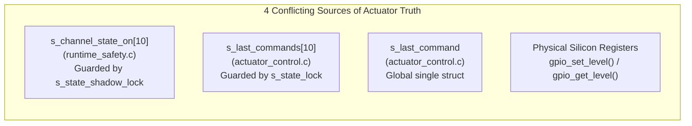

# 🍝 Spaghetti Architecture, Code Smells & Maintainability Audit

Beyond real-time timing hazards, the HydroponicsIDF firmware suffers from acute architectural anti-patterns, violation of basic software engineering principles, brittle string-manipulation hacks, and deceptive hardware configuration headers.

---

## 1. VULN-05: The 1,870-Line `sensor_telemetry.c` God-File

### Severity: 🟠 HIGH
**Source Location:** `main/sensor_telemetry.c` (1,870 lines of code)

The **Single Responsibility Principle (SRP)** states that a module should have one, and only one, reason to change. `sensor_telemetry.c` violates SRP more aggressively than any other component in the repository:

```mermaid
graph TD
    GodFile["sensor_telemetry.c\n(1,870 Lines of Monolithic Code)"]

    GodFile --> F1["DS18B20 1-Wire Driver\n(RMT Bus, Enumeration, Reinit)"]
    GodFile --> F2["ADS1115 I2C ADC Driver\n(Register Bitbanging & Timing)"]
    GodFile --> F3["pH Serial UART Protocol\n(PHA Frame Parsing)"]
    GodFile --> F4["GY-SHT31 Wrapper & Math\n(Tetens VPD Calculation)"]
    GodFile --> F5["Water Level Debounce\n(Software esp_timer Engine)"]
    GodFile --> F6["Rolling Moving Average\n(30-Sample Circular Buffers)"]
    GodFile --> F7["Hand-Rolled JSON Parser\n(String Matching Math)"]
    GodFile --> F8["NVS Flash Persistence\n(Retry Loops & Verification)"]
    GodFile --> F9["MQTT Pub/Sub Integration\n(Topics & Resubscription)"]

    style GodFile fill:#dc2626,stroke:#991b1b,stroke-width:3px,color:#fff
    style F1 fill:#1e293b,stroke:#334155,color:#fff
    style F2 fill:#1e293b,stroke:#334155,color:#fff
    style F3 fill:#1e293b,stroke:#334155,color:#fff
    style F4 fill:#1e293b,stroke:#334155,color:#fff
    style F5 fill:#1e293b,stroke:#334155,color:#fff
    style F6 fill:#1e293b,stroke:#334155,color:#fff
    style F7 fill:#1e293b,stroke:#334155,color:#fff
    style F8 fill:#1e293b,stroke:#334155,color:#fff
    style F9 fill:#1e293b,stroke:#334155,color:#fff
```



### Architectural Sins:
1. **High Coupling / Zero Cohesion**: Low-level hardware drivers (I2C bit masks, 1-Wire RMT pulses) are mixed in the same file with high-level application business logic (VPD calculation, rolling averages, MQTT callback registration, and NVS flash writing).
2. **Brittle Modularity**: If an engineer modifies the ADS1115 conversion timing, they risk destabilizing the 1-Wire recovery backoff timer or causing mutex lock contention with the SHT31 sensor.
3. **Duplication of NVS Logic**: While a dedicated file `sensor_calibration_nvs.c` exists, `sensor_telemetry.c` still contains hundreds of lines of NVS retry logic (`handle_cali_set`), verifying and loading the exact same data.

---

## 2. VULN-06: Fragile Hand-Rolled JSON Parser (`json_get_float`)

### Severity: 🟠 HIGH
**Source Location:** `main/sensor_telemetry.c` (Lines 1055–1069)

To parse two-point calibration messages over MQTT, the firmware implements an ad-hoc string-matching function instead of utilizing an established JSON parser:

```c
// sensor_telemetry.c:1055-1069
static bool json_get_float(const char *json, const char *key, float *out)
{
    /* Build search pattern: "key": */
    char pattern[48];
    snprintf(pattern, sizeof(pattern), "\"%s\":", key);
    const char *p = strstr(json, pattern);
    if (p == NULL) return false;
    p += strlen(pattern);
    while (*p == ' ' || *p == '\t') p++;
    char *end = NULL;
    double v = strtod(p, &end);
    if (end == p) return false;
    *out = (float)v;
    return true;
}
```

### Why This Fails in Production:
1. **RFC 8259 Whitespace Violation**:
   Valid JSON permits whitespace between the key name and the colon:
   ```json
   { "actual_1" : 4.01, "raw_1" : 16250.0 }
   ```
   Because `pattern` is hardcoded as `"actual_1":`, `strstr` returns `NULL`. The calibration is rejected with `"missing field: actual_1"`!
2. **Nested Object Blindness**:
   If the JSON contains nested objects or metadata sharing the same key name, `strstr` matches the first occurrence blindly without grammar awareness.
3. **Absurdity of Hand-Rolling**:
   ESP-IDF comes bundled with **`cJSON`**, an enterprise-grade, thoroughly tested RFC-compliant JSON library. In fact, `cJSON` is already present in the build tree! Implementing a buggy 15-line substring searcher is quintessential amateur embedded code smell.

---

## 3. VULN-07: Deceptive Pin Configuration Header (`pin_config.h`)

### Severity: 🟡 MEDIUM
**Source Locations:**
- `main/pin_config.h` (Line 63)
- `main/setup_button.c` (Line 8)
- `main/main.c` (Lines 44 & 59)

### The Defect:
A central pinout header (`pin_config.h`) exists to provide a **single source of truth** for all hardware GPIO assignments. 

In `main/pin_config.h`:
```c
/* Setup / reconfiguration button */
#define PIN_SETUP_BUTTON 6  // <--- CLAIMED TO BE GPIO 6!
```

Yet in `main/setup_button.c`:
```c
#define SETUP_BUTTON_GPIO 46  // <--- COMPLETELY IGNORES PIN_CONFIG.H AND USES 46!
```

And in `main/main.c`:
```c
// Lines 44 & 59
ESP_LOGI(TAG, "Hold GPIO%d for 3 s at any time to reconfigure.", 46); // <--- HARDCODED LITERAL!
ESP_LOGI(TAG, "Waiting for setup button hold (3 s) on GPIO%d...", 46);
```

### Dangerous Engineering Consequence:
If a hardware engineer designs a rev 2.0 PCB and changes `PIN_SETUP_BUTTON` from `6` to `7` in `pin_config.h`, the firmware **compiles with zero warnings but continues reading GPIO 46**! The hardware button is rendered completely dead. This is an egregious violation of configuration encapsulation.

---

## 4. Zombie & Dead Code Left in Production Files

### Severity: 🟢 LOW (Hygiene / Code Smell)

1. **Dead Median Filter (`sensor_telemetry.c:751-776`)**:
   A 25-line function `ads1115_read_tds_median()` is left commented out inside an active `#if 0` block directly in the middle of production source code:
   ```c
   #if 0
   static esp_err_t ads1115_read_tds_median(int *out_raw)
   {
       // 25 lines of dead code taking up space...
   }
   #endif
   ```
2. **Stray Debug Marker Comments (`pin_config.h:37`)**:
   ```c
   /* Status / indicator LEDs */
   //#pilot1
   #define PIN_LED_CONNECTION 1
   ```
   Vestiges of bench prototypes (`#pilot1`) left uncleaned in production release headers.

---

## 5. The Magic Numbers Epidemic

The firmware is littered with naked numerical literals without named symbolic constants:

| File & Line | Naked Literal | Meaning / Real Identity | Risk of Hardcoding |
|---|:---:|---|---|
| `runtime_tasks.c:923-979` | `10` | 10 ms artificial delay between every MQTT publish | Repeated **11 times** sequentially. Artificially inflates telemetry cycle time by 110 ms. |
| `sensor_telemetry.c:538` | `80` | ADS1115 conversion wait time in ms | Should be calculated from data rate (`128 SPS = 7.8 ms`). 80 ms blocks I2C 10x longer than necessary. |
| `sensor_telemetry.c:72` | `30` | Rolling average window size | Hardcoded array bounds; modifying window requires updating 6 different lines. |
| `web_portal.c:657` | `2 * 60 * 1000` | 2-minute autostart timeout budget | Inline arithmetic literal; desynchronized from `120000` in line 679. |
| `ota_update.c:57` | `8123` | Home Assistant default HTTP port | Hardcoded in URL formatting; cannot connect to standard port 80/8080/443 OTA servers. |

---

## 6. Redundant & Desynchronized State Shadowing

To track whether an actuator is currently ON or OFF, the firmware maintains **four separate, redundant copies of state**:



### The Desynchronization Hazard:
When `SafetyTask` enters Safe Mode, it calls `actuator_control_force_off()`:
- It drives the GPIO register LOW (updating **S4**).
- It calls `runtime_safety_update_channel_state(ch, false)` (updating **S1**).
- **BUT IT FAILS TO UPDATE `s_last_commands[ch]` (S2) or `s_last_command` (S3)!**

If a technician immediately queries the web portal debug endpoint (`GET /debug/data`), the web server reads `s_last_commands` and reports to the technician that the **pump is still ON**, even though the GPIO was forced OFF!

