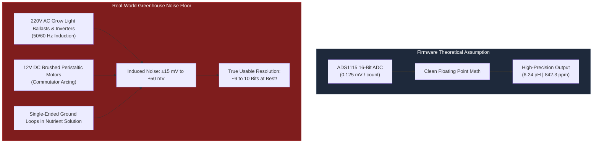

# ⚗️ Sensor Physics, Agronomic Chemistry & Actuator Dynamics Critique

Embedded firmware cannot be evaluated in isolation from the physical environment it controls. This critique examines the disconnect between the mathematical models in the firmware and the real-world physical chemistry, electromagnetic interference, and fluid dynamics of commercial hydroponic greenhouses.

---

## 1. The Illusion of 16-Bit Precision vs. Analog Reality

### The Disconnect:
The firmware uses the Texas Instruments ADS1115 ADC, boasting **16-bit resolution** (65,536 quantization levels) with a Full-Scale Range of $\pm 4.096\text{ V}$. Each LSB corresponds to:
$$\text{LSB Resolution} = \frac{4.096\text{ V}}{32768} = 0.125\text{ mV (125 }\mu\text{V)}$$

The telemetry engine proudly formats and publishes values with high precision:
- `pH`: `"%.2f"` (e.g. `6.24`)
- `TDS`: `"%.1f"` ppm (e.g. `842.3` ppm)



### The Physical Flaws:
1. **Electrode Impedance vs. Single-Ended Grounding**:
   Standard glass pH electrodes have an internal impedance between **$10^7\ \Omega$ and $10^9\ \Omega$ (10 MΩ to 1 GΩ)**. When immersed in a conductive nutrient bath with AC pumps and LED ballast switching supplies, stray currents flow through the solution to ground.
2. **Missing Differential Sensing**:
   The ADS1115 is configured in single-ended mode (`ADS1115_MUX_AIN1_GND`). In single-ended mode, any voltage fluctuation in the ground plane between the sensor probe and the ESP32 board is directly digitized as legitimate signal!
3. **Conclusion**:
   A ground bounce of just $15\text{ mV}$ shifts a standard $59.16\text{ mV/pH}$ Nernst slope by **$0.25\text{ pH}$ units**. The lower 5 to 6 bits of the ADS1115 are purely digitizing electrical noise. Reporting two decimal places creates dangerous false confidence for closed-loop automation.

---

## 2. The Two-Point Linear Model Fallacy in Physical Chemistry

The calibration subsystem (`handle_cali_set`) models all sensors as a pure straight line:
$$y = \text{Slope} \cdot x + \text{Offset}$$

While mathematically convenient, this assumption fails real-world agronomic chemistry:

### A. Non-Linearity of Electrical Conductivity (EC / TDS)
At low concentrations (< 800 ppm), conductivity is reasonably proportional to ion concentration. However, at higher concentrations (typical in flowering crops: 1,500 – 2,500 ppm), the **Debye-Hückel-Onsager theory of electrolytic solutions** dictates that ion-ion interactions and ion pairing retard migration velocity.
- The actual conductivity curve bends downward.
- A two-point linear calibration between 0 ppm and 1,000 ppm will produce **systematic errors exceeding 15% to 20% at 2,000 ppm**, leading to under-fertilization and crop nutrient deficiencies.

### B. pH Electrode Asymmetry & Alkaline Error
According to the Nernst equation:
$$E = E_0 - \frac{2.303 R T}{F} \cdot \text{pH}$$
The theoretical slope is $-59.16\text{ mV/pH}$ at 25°C. In reality:
- As glass electrodes age, the slope degrades asymmetrically across acidic and alkaline ranges.
- Commercial laboratory meters use a **minimum of 3 calibration points** (pH 4.01, pH 7.00, and pH 10.01) with segmented piecewise slopes (separate acidic and basic slope calculations). The firmware's single linear fit cannot simultaneously achieve accuracy across both pH 5.5 and pH 8.0.

---

## 3. Water Level Sloshing & The 5-Second Debounce Blind Spot

In `sensor_telemetry.c:261-328`, the digital float switch uses a 5-second software debounce timer:
```c
#define WATER_LEVEL_DEBOUNCE_LOW_MS 5000
#define WATER_LEVEL_BOUNCE_WINDOW_MS 200
```

### The Failure Scenario:
- In active hydroponic reservoirs, aeration bubbler stones (Relay 3) and high-volume return manifolds generate **standing surface waves** with typical periods between 2 and 4 seconds.
- As waves lap across the mechanical float switch:
  1. The float drops LOW for 2 seconds (starts 5-second debounce timer).
  2. A wave crest lifts the float HIGH for 0.3 seconds.
  3. The HIGH state cancels the debounce timer (`esp_timer_stop`).
  4. The float drops LOW again for 2 seconds.
- **The Blind Spot**:
  The reservoir can be actively emptying through a ruptured pipe, but because wave crests periodically lift the float for 300 ms, the debounce timer is continually cancelled before 5,000 ms can elapse. The firmware **continues reporting Tank FULL (1)** until the water level has dropped completely below the physical float mechanism!

---

## 4. Perpetual Circulation Pump vs. Dry-Run Motor Burnout

In [[02 - Subsystems/Dosing & Actuator Control|Dosing & Actuator Control]], the firmware proudly documents the **Perpetual Circulation Pump Protection Principle**: GPIO 13 is kept `HIGH` indefinitely and cannot be turned off by software commands or Safe Mode.

### The Engineering Paradox:
> [!CAUTION]
> Submersible pumps (magnetic drive impellers) rely on the pumped liquid for **bearing lubrication and motor stator cooling**.

If a pipe breaks, a valve fails, or the reservoir drains completely:
1. The water level drops to zero.
2. The firmware prevents GPIO 13 from ever being shut off.
3. The circulation pump runs completely dry.
4. Within 15 to 30 minutes of dry operation:
   - Friction melts the ceramic/ferrite impeller shaft.
   - Stator potting compound overheats and catches fire or trips upstream thermal fuses.
   - The pump motor burns out permanently.

**Remediation**:
Perpetual circulation must be conditioned on **positive water level verification**. If water level reports LOW continuously for more than a safety margin (e.g. 60 seconds), the circulation pump MUST be deactivated to prevent dry-run equipment destruction.

