# 🔌 Embedded Hardware Architecture & System Topology

This document establishes the hardware design specifications, system block diagrams, power rail distribution, and isolation boundaries for the **HydroponicsIDF** physical embedded controller.

---

## 1. Physical System Block Diagram

```mermaid
flowchart TD
    subgraph Power_Subsystem["⚡ Power Ingress & Conditioning"]
        DC_In["12V / 24V DC Field Power Supply\n(Industrial DIN-Rail PSU, 10A)"]
        TVS_In["TVS Diode + Polarity Protection\n(SMAJ15A + P-MOSFET Reverse Protection)"]
        Buck_5V["Synchronous Buck Converter (12V -> 5V @ 3A)\n(TI TPS54302 / MP1584)"]
        LDO_3V3["Ultra-Low-Noise LDO (5V -> 3.3V @ 1A)\n(AMS1117-3.3 / TI TLV75733P)"]
        Iso_DC["Isolated DC-DC (Optional)\n(B0505S-1WR3 for Analog AFE)"]
    end

    subgraph Compute_Core["🧠 Microcontroller Core"]
        ESP32S3["ESP32-S3-WROOM-1 Module\n(Xtensa Dual-Core @ 240 MHz, 8MB Flash)"]
        Antenna["PCB Meander Antenna / U.FL IPEX\n(Keepout Clearance on all layers)"]
        Reset_Circuit["RC Reset + Auto-Download (EN / IO0)\n(CH340C / CP2102N USB-to-UART)"]
    end

    subgraph Actuator_Power_Drivers["⚡ Actuator & Relay Switching (Noisy Domain)"]
        Opto_Relays["Optocoupler Isolation Array\n(4x PC817 / TLP281)"]
        MOSFET_Pumps["N-Channel Power MOSFETs\n(AO3400A / IRLML6344TRPBF)\nFlyback Diodes: SS14 Schottky"]
        Relay_AC["4x SPDT Power Relays (10A 250VAC)\nRC Snubbers across AC contacts"]
        HW_Interlock["Electromechanical SPDT Interlock\n(pH Up vs pH Down Hardware Lock)"]
    end

    subgraph Sensor_AFE["🧪 Analog Front-End & Instrumentation (Quiet Domain)"]
        ADS1115["TI ADS1115 16-Bit I2C ADC (0x48)\nFiltered VDD + Decoupling"]
        pH_AFE["High-Impedance pH Front-End\n(LMC6001 / OPA129 with Guard Ring)"]
        TDS_AFE["AC-Excited TDS Conductivity Driver\n(555 Timer / PWM AC Signal Generator)"]
        OW_Bus["DS18B20 1-Wire Digital Temp\n(4.7kΩ Pull-Up + TVS Clamp)"]
        SHT31_Sensor["Sensirion SHT31 Temp & RH\n(I2C Address 0x44)"]
        Float_Filter["RC Low-Pass Filtered Float In\n(GPIO 5 with 10kΩ Pull-Up)"]
    end

    subgraph Local_HMI["📟 Local Human-Machine Interface"]
        LCD2004["20x4 Character LCD Display\n(PCF8574 I2C Backpack @ 0x27 / 0x3F)"]
        LEDs["Status LEDs (Blue Conn, Red Fault)\n(Current Limiting Resistors 330Ω)"]
        Piezo["5V Active Piezo Buzzer\n(Driven via NPN Transistor SS8050)"]
        Tact_Button["Setup Tactile Push Button\n(GPIO 46 with Hardware Debounce)"]
    end

    %% Power Distribution
    DC_In --> TVS_In --> Buck_5V
    TVS_In -->|Unregulated 12V Rail| MOSFET_Pumps
    TVS_In -->|Unregulated 12V Rail| Relay_AC
    Buck_5V -->|5V Power Rail| LDO_3V3
    Buck_5V -->|5V Power Rail| Opto_Relays
    Buck_5V -->|5V Power Rail| LCD2004
    Buck_5V -->|5V Power Rail| Piezo
    LDO_3V3 -->|Clean 3.3V Digital Rail| ESP32S3
    LDO_3V3 -->|Clean 3.3V Rail| SHT31_Sensor
    LDO_3V3 -->|Clean 3.3V Rail| OW_Bus
    Iso_DC -->|Isolated 5V Analog Rail| ADS1115
    Iso_DC -->|Isolated 5V Analog Rail| pH_AFE
    Iso_DC -->|Isolated 5V Analog Rail| TDS_AFE

    %% Control Signals
    ESP32S3 -->|GPIO 12, 41, 40, 39, 38, 13| MOSFET_Pumps
    MOSFET_Pumps --> HW_Interlock
    ESP32S3 -->|GPIO 47, 14, 21, 45| Opto_Relays --> Relay_AC
    ESP32S3 -->|I2C0: GPIO 16 SDA, 15 SCL| ADS1115
    ESP32S3 -->|I2C0: GPIO 16 SDA, 15 SCL| LCD2004
    ESP32S3 -->|I2C0: GPIO 16 SDA, 15 SCL| SHT31_Sensor
    ESP32S3 -->|UART1: GPIO 17 TX, 18 RX| pH_AFE
    OW_Bus -->|GPIO 8| ESP32S3
    Float_Filter -->|GPIO 5| ESP32S3
    Tact_Button -->|GPIO 46| ESP32S3
    ESP32S3 -->|GPIO 1, 2| LEDs
    ESP32S3 -->|GPIO 42| Piezo

    style Power_Subsystem fill:#334155,stroke:#475569,stroke-width:1px,color:#fff
    style Compute_Core fill:#0f766e,stroke:#115e59,stroke-width:2px,color:#fff
    style Actuator_Power_Drivers fill:#7f1d1d,stroke:#991b1b,stroke-width:1px,color:#fff
    style Sensor_AFE fill:#1e3a8a,stroke:#1e40af,stroke-width:1px,color:#fff
    style Local_HMI fill:#374151,stroke:#4b5563,stroke-width:1px,color:#fff
```

---

## 2. Power Supply Tree & Rail Requirements

Agricultural environments experience substantial line surges, inductive kickbacks, and brownouts caused by large pumps cycling on and off. The PCB must strictly isolate high-current inductive switching from the sensitive 3.3V logic and microvolt-level analog front-ends:

| Power Rail | Nominal Voltage | Max Current | Source / Topology | Noise Target | Powered Subsystems |
|:---:|:---:|:---:|---|:---:|---|
| **`+12V_RAW`** | 12.0 V DC (10.5V–14.8V) | 8.0 A | External 12V 10A Industrial PSU via 5.08mm Terminal Block | $< 250\text{ mV}_\text{p-p}$ | 5x Peristaltic Pumps, 1x Solenoid Valve, 4x Relay Coils |
| **`+5V_DIGITAL`** | 5.0 V DC ($\pm 3\%$) | 2.5 A | High-Efficiency Step-Down Buck (TPS54302 or MP1584EN) | $< 50\text{ mV}_\text{p-p}$ | 20x4 LCD Backlight, Piezo Buzzer, Optocoupler LEDs |
| **`+3V3_MCU`** | 3.30 V DC ($\pm 1.5\%$) | 800 mA | LDO Linear Regulator (TLV75733P or AMS1117-3.3) | $< 15\text{ mV}_\text{p-p}$ | ESP32-S3 Module, Flash, Pull-Up Resistors, SHT31 |
| **`+5V_ANALOG`** | 5.0 V DC Isolated | 200 mA | Isolated DC-DC Converter (Mornsun B0505S-1WR3) + LC Filter | **$< 2\text{ mV}_\text{p-p}$** | ADS1115 ADC, pH Analog Front-End, TDS Oscillator |

---

## 3. Galvanic & Domain Isolation Boundaries

To ensure industrial reliability and prevent ground loop noise from corrupting pH and TDS measurements:

1. **Actuator Ground Isolation**:
   - The high-current ground carrying PWM switching currents from the 12V DC brushed peristaltic motors must **NEVER share a common copper path** with the ESP32-S3 analog ground.
   - Traces return directly to the main 12V DC terminal block in a **Star-Ground Topology**.
2. **AC Mains Isolation**:
   - Relay outputs (Relay 1 through Relay 4) switch 220V AC live mains.
   - The PCB must maintain a strict **Milling Slot / Air Isolation Trench ($> 2.0\text{ mm}$ width)** under the relays, separating AC contacts from low-voltage DC logic with **$\ge 6.3\text{ mm}$ creepage distance** compliant with **IEC 60950 / IEC 62368**.
3. **Electrode Solution Isolation**:
   - Because water is conductive, immersion of an unisolated TDS probe creates a current return path through the nutrient solution into the pH glass bulb reference electrode.
   - An isolated DC-DC converter (B0505S) and digital I2C isolator (ADuM1250 or ISO1540) are recommended for professional deployments to eliminate solution ground loops completely.

