# 📐 PCB Layout, High-Voltage Clearance & EMC Design Guidelines

Designing a printed circuit board that combines sensitive microvolt-level chemical sensors, high-speed 240 MHz Wi-Fi radio frequencies, 12V DC inductive pump switching, and 220V AC mains contactors requires strict adherence to physical layout discipline and electromagnetic compatibility (EMC) standards.

---

## 1. PCB Stackup Recommendations

For commercial agricultural automation, a **4-layer PCB stackup** is mandatory to pass CE / FCC radiated emissions and prevent switching noise from corrupting ADC conversions:

```
Layer 1 (Top)      ─── [ Component Pads, RF Microstrip, High-Speed Signals ]
Dielectric 1 (Prepreg 0.1mm)
Layer 2 (Inner 1)  ─── [ UNBROKEN SOLID GROUND PLANE (GND) ]
Dielectric 2 (Core 1.2mm)
Layer 3 (Inner 2)  ─── [ POWER SPLIT PLANES (+12V, +5V, +3V3) ]
Dielectric 3 (Prepreg 0.1mm)
Layer 4 (Bottom)   ─── [ Slow Actuator Traces, AC Mains Traces, Bottom GND ]
```

### Why a Solid Ground Plane on Layer 2 is Essential:
1. **Low Inductance Return Paths**: High-frequency return currents from the ESP32-S3 Wi-Fi transmitter flow directly underneath the signal traces. A solid ground plane minimizes loop area, cutting radiated RF emissions by $> 30\text{ dB}$.
2. **Shielding Sensitive Sensors**: The Layer 2 ground plane acts as an electrostatic barrier between Layer 3 power switching noise and the Layer 1 high-impedance pH op-amp inputs.

---

## 2. Board Partitioning & Three-Zone Architecture

To prevent motor noise and high-voltage AC transients from destroying low-voltage logic, the board must be physically partitioned into **three isolated functional zones**:

```mermaid
graph LR
    subgraph Zone_AC["Zone 1: High-Voltage AC Domain (Right Edge)"]
        AC_Relays["4x Relays & AC Screw Terminals\n(220V AC Live / Neutral)"]
        Snubbers["RC Snubber Networks\n(0.1uF 400V + 47Ω 1W)"]
    end

    subgraph Zone_DC_Power["Zone 2: 12V Inductive Switching Domain (Center)"]
        MOSFETs["6x Power N-MOSFETs (AO3400A)\nFlyback Schottky Diodes (SS14)"]
        Buck["12V -> 5V Step-Down Buck (TPS54302)\nField DC Input Terminals"]
    end

    subgraph Zone_Quiet_Logic["Zone 3: Quiet MCU & Analog Domain (Left Edge)"]
        MCU["ESP32-S3 Module (Wi-Fi Antenna)\nClean 3.3V LDO"]
        AFE["ADS1115 I2C ADC & pH Op-Amp\nBNC Connector & Guard Ring"]
    end

    Zone_AC ===|Milling Slot & 6.3mm Creepage| Zone_DC_Power
    Zone_DC_Power ===|Optocoupler Gap & Star Ground| Zone_Quiet_Logic

    style Zone_AC fill:#7f1d1d,stroke:#991b1b,stroke-width:2px,color:#fff
    style Zone_DC_Power fill:#c2410c,stroke:#9a3412,stroke-width:2px,color:#fff
    style Zone_Quiet_Logic fill:#0f766e,stroke:#115e59,stroke-width:2px,color:#fff
```



---

## 3. High-Voltage Clearance, Creepage & Isolation Slots

When switching 220V/240V AC mains through on-board relays, the PCB must comply with **IEC 60950-1** and **IEC 62368-1** safety standards for reinforced insulation:

| Parameter | Standard Requirement | Implementation on HydroponicsIDF PCB |
|---|:---:|---|
| **Air Clearance** | $\ge 3.0\text{ mm}$ (Basic) / $\ge 5.0\text{ mm}$ (Reinforced) | $\ge 6.0\text{ mm}$ between AC contact pins and low-voltage DC copper. |
| **Surface Creepage** | $\ge 6.3\text{ mm}$ (Pollution Degree 2, Material Group IIIb) | $\ge 8.0\text{ mm}$ surface trace distance across FR4 substrate. |
| **Isolation Milling Slot** | Recommended for high-humidity environments | **2.0 mm wide physical air slot** routed completely through the board under the relay contact gap. |

```
                       High-Voltage Isolation Air Slot
    +5V Coil Pin [ O ]                            [ O ] AC Live In (220V)
                                ┌──────────────┐
    +5V Coil Pin [ O ]          │ PHYSICAL AIR │  [ O ] AC NO (To Lamp)
                                │ MILLING SLOT │
    GND Drive    [ O ]          │ (WIDTH: 2mm) │  [ O ] AC NC Contact
                                └──────────────┘
    ◄── Low-Voltage DC Domain ──►              ◄── High-Voltage AC Domain ──►
```
*Note: In greenhouse environments with condensing humidity ($RH > 90\%$), dust and moisture deposit on the PCB surface, leading to conductive carbon tracking. An air slot eliminates surface creepage entirely by replacing FR4 with open air.*

---

## 4. Trace Width & Current Carrying Rules (IPC-2152)

Pumps and solenoid valves draw significant DC surge currents upon startup:

- **12V DC Peristaltic Pump**: Continuous current $\approx 0.5\text{A}$ to $0.8\text{A}$; inductive stall current up to $2.5\text{A}$.
- **12V DC Freshwater Solenoid**: Pull-in current up to $1.8\text{A}$.
- **Total Simultaneous Load**: Up to $6.0\text{A}$ across common power traces.

### Trace Calculation Table (for 1 oz / 35 µm Copper, 20°C Rise):

| Signal / Trace | Peak Current | Minimum Trace Width | Recommended Design Width |
|---|:---:|:---:|:---:|
| **Main +12V_IN Power Trace** | $8.0\text{ A}$ | $5.2\text{ mm}$ (205 mils) | **$6.0\text{ mm}$ (236 mils)** + exposed copper tinned with solder |
| **Individual Pump Drain Traces** | $2.5\text{ A}$ | $1.2\text{ mm}$ (47 mils) | **$1.8\text{ mm}$ (70 mils)** |
| **+5V Digital Rail** | $2.0\text{ A}$ | $0.9\text{ mm}$ (35 mils) | **$1.5\text{ mm}$ (60 mils)** |
| **+3V3 Logic Rail** | $0.8\text{ A}$ | $0.35\text{ mm}$ (14 mils) | **$0.8\text{ mm}$ (31 mils)** |
| **Low-Current Analog / I2C / GPIO**| $< 20\text{ mA}$ | $0.15\text{ mm}$ (6 mils) | **$0.25\text{ mm}$ (10 mils)** |

---

## 5. RF Antenna Placement & Layout Guidelines

The ESP32-S3-WROOM-1 uses an onboard PCB meander inverted-F antenna (MIFA) tuned for $2.4\text{ GHz}$ Wi-Fi:

```
      CORRECT ANTENNA PLACEMENT                INCORRECT ANTENNA PLACEMENT
   ┌─────────────────────────────┐        ┌─────────────────────────────┐
   │ ┌─────────┐                 │        │                             │
   │ │ Antenna │ OVERHANG ON EDGE│        │      ┌─────────┐            │
   │ └─────────┘                 │        │      │ Antenna │ TRAPPED IN │
   │ ┌─────────┐                 │        │      └─────────┘ CENTER     │
   │ │ESP32-S3 │                 │        │      ┌─────────┐            │
   │ └─────────┘                 │        │      │ESP32-S3 │            │
   │                             │        │      └─────────┘            │
   │                             │        │                             │
   │   NO COPPER ON ANY LAYER    │        │ COPPER TRACES SURROUNDING   │
   │    UNDER ANTENNA REGION     │        │ CAUSES SIGNAL ATTENUATION!  │
   └─────────────────────────────┘        └─────────────────────────────┘
```

### Critical RF Rules:
1. **Edge Overhang**: Position the module such that the antenna section extends past or sits directly on the outer edge of the PCB.
2. **Keepout Zone**: A rectangular keepout of **$15\text{ mm} \times 8\text{ mm}$** beneath and around the antenna must be completely free of copper traces, ground planes, and metal mounting hardware across **all 4 layers**.
3. **Ground Perimeter Stitching**: Place stitching vias spaced $\le 3\text{ mm}$ ($\lambda / 20$) along the edge of the ground plane bordering the module to suppress parasitic ground edge radiation.

---

## 6. Guard Ring Implementation for Analog pH Inputs

Because the source impedance of glass pH probes is $10^7$ to $10^9\ \Omega$, surface leakage currents of only $50\text{ pA}$ across PCB dust or flux residue will induce a catastrophic measurement error of $0.5\text{ pH}$.

```
             Laboratory-Grade Guard Ring Layout
        ┌──────────────────────────────────────────────┐
        │       GUARD TRACE (Driven at V_REF)          │
        │    ┌──────────────────────────────────┐      │
        │    │                                  │      │
        │    │       BNC Center Signal Pad      │      │
        │    │             (pH Input)           │      │
        │    │                                  │      │
        │    └──────────────────────────────────┘      │
        │                                              │
        └──────────────────────────────────────────────┘
```
- **Top Layer**: A continuous copper ring completely surrounds the BNC center conductor pad, the 1 nF filtering capacitor pad, and the non-inverting input pin of the buffer op-amp (LMC6001).
- **Solder Mask Stripping**: The solder mask must be stripped from the guard ring trace so it remains exposed tin/gold, preventing moisture absorption in the soldermask polymer.
- **Electrical Connection**: The guard ring is driven at the **exact same electrical potential** as the input signal ($V_{\text{REF}} \approx 2.048\text{V}$). Because $\Delta V = 0\text{V}$ between the signal trace and the guard ring, leakage current is zero ($I = \Delta V / R = 0$).

