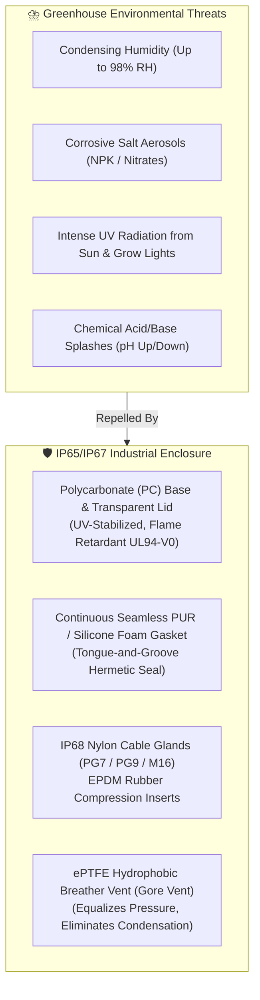

# 📦 Enclosure Selection, Mechanical Ingress Protection & Thermal Design

Operating an embedded microcontroller in commercial greenhouse environments presents severe environmental hazards: relative humidity frequently reaches **$95\%$ condensing**, air carries corrosive fertilizer salt aerosols, grow lamps emit intense ultraviolet radiation, and water splashing occurs during maintenance.

---

## 1. Enclosure Material & Ingress Protection Specifications



### Material Selection: Polycarbonate vs. ABS
> [!WARNING]
> Standard ABS plastic enclosures degrade rapidly under greenhouse high-pressure sodium (HPS) and full-spectrum LED grow lighting. Within 12 months, UV exposure turns ABS brittle, cracking screw standoffs and degrading water seals.

- **Mandatory Material**: **UV-Stabilized Polycarbonate (PC)** or Glass-Fiber Reinforced Polyester (GRP).
- **Lid**: Clear, high-impact polycarbonate lid enabling field personnel to read the 20x4 LCD and view status LEDs without unsealing the enclosure.
- **Rating**: **IP65** (Dust-tight and protected against water jets from any direction) or **IP67** (Protected against short-term immersion).

---

## 2. Cable Gland Pass-Throughs & Drip Loops

Every electrical conductor entering the enclosure is a potential path for moisture ingress via capillary action or liquid tracking:

```
                GREENHOUSE CABLE INGRESS WITH DRIP LOOP
   Enclosure Wall
      │
      ├─── [ IP68 Waterproof Cable Gland (PG7 / PG9) ]
      │         │
      │         │  ◄── Cable clamped with EPDM rubber seal
      │         │
      │         │
      │         │     [ CRITICAL DRIP LOOP ]
      │         └─────┐ (Cable bends downward below gland level)
      │               │
      │               ▼
      │           (Lowest Point: Condensed water drips onto floor)
      │               │
      │               └──────────────────────────► To Submersible Pump / Sensor
```

### Gland Assignment Table:

| Gland Size | Hole Diameter | Cable Clamping Range | Dedicated Cable Function | Cable Type |
|:---:|:---:|:---:|---|---|
| **M20** | $20.5\text{ mm}$ | $6.0\text{ mm} - 12.0\text{ mm}$ | AC Mains Input & Relay Outputs (Relays 1–4) | 3-Core $1.5\text{ mm}^2$ H07RN-F Heavy Rubber Cable |
| **M16** | $16.5\text{ mm}$ | $4.0\text{ mm} - 8.0\text{ mm}$ | Main 12V DC Field Power Supply Ingress | 2-Core $1.5\text{ mm}^2$ Flexible PVC Power Cable |
| **PG9** | $15.5\text{ mm}$ | $4.0\text{ mm} - 8.0\text{ mm}$ | 5x Peristaltic Pump & Valve 12V DC Wiring | 10-Conductor Shielded Industrial Control Cable |
| **PG7** | $12.5\text{ mm}$ | $3.0\text{ mm} - 6.5\text{ mm}$ | DS18B20 Water Temperature & Float Switch | 2-Core & 3-Core Shielded Sensor Cable |
| **BNC Feedthrough** | $12.8\text{ mm}$ | Threaded Nut | pH Probe Coaxial Cable Connection | Waterproof Isolated BNC Bulkhead Jack |

---

## 3. The Condensation Paradox & The ePTFE Breather Vent

A common failure mode in sealed IP67 enclosures is the **Internal Condensation Vacuum Effect**:
1. During the day, internal electronics heat the air inside the sealed box to $45^\circ\text{C}$, increasing internal pressure.
2. At night, ambient greenhouse temperatures drop to $18^\circ\text{C}$.
3. The internal air contracts, creating a **negative pressure vacuum** inside the box.
4. Over months, this vacuum sucks humid moist air past cable gland micro-gaps.
5. Once inside, moisture condenses on the cold PCB surfaces, causing corrosion, high-impedance pH signal leakage, and short circuits.

### Engineering Solution: Protective ePTFE Breather Vent
Install an **M12 ePTFE Membrane Breather Vent (Gore Protective Vent PMF100444)** on the bottom wall of the enclosure:
- **Gas Permeable**: Allows air molecules to flow freely, equalizing pressure continuously during thermal cycles.
- **Hydrophobic & Oleophobic**: Liquid water droplets, aerosols, and dust are completely blocked ($100\%$ liquid barrier up to $> 30\text{ kPa}$ water intrusion pressure).
- **Zero Internal Condensation**: Dew points inside the enclosure remain equal to ambient, completely eliminating internal condensation.

---

## 4. Thermal Budget & Heat Dissipation

The enclosure is sealed without active ventilation fans to prevent chemical aerosol ingress. Internal heat generation must be dissipated via passive conduction through the enclosure walls:

### Heat Generation Budget:
- **ESP32-S3 Module**: $0.80\text{ W}$ (Average with periodic Wi-Fi TX bursts)
- **Buck Converter (TPS54302)**: $0.45\text{ W}$ ($92\%$ efficiency converting 12V to 5V @ 1A)
- **4x Relay Coils (5V @ 72mA each)**: $1.44\text{ W}$ (When all 4 relays are energized)
- **MOSFET Conduction Losses**: $0.15\text{ W}$ ($I^2 R$ with $R_{DS(on)} = 28\text{ m}\Omega$ @ 2A)
- **Total Continuous Heat Load ($P_{\text{total}}$)**: **$\approx 2.84\text{ Watts}$**

### Thermal Dissipation Calculation:
For a polycarbonate box with surface area $A \approx 0.08\text{ m}^2$ and thermal transfer coefficient $k \approx 4.5\text{ W/m}^2\text{K}$:
$$\Delta T = \frac{P}{k \cdot A} = \frac{2.84}{4.5 \cdot 0.08} \approx 7.9^\circ\text{C}$$

An internal temperature rise of $\approx 8^\circ\text{C}$ above ambient is well within the operating specifications of the industrial ESP32-S3 (rated $-40^\circ\text{C}$ to $+105^\circ\text{C}$) and industrial relays (rated up to $+85^\circ\text{C}$).

