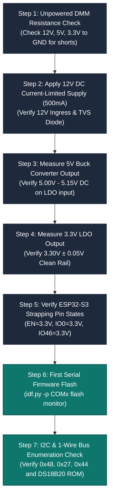

# 🛠️ Assembly, Hardware Bring-Up & Field Commissioning Manual

This manual provides the step-by-step engineering protocol for assembling, bench-testing, flashing, and field-commissioning a new HydroponicsIDF controller unit.

---

## 1. PCB Assembly & Critical Flux Cleaning Protocol

Surface Mount Technology (SMT) assembly can be completed using standard reflow soldering or hand-assembly. However, chemical instrumentation boards require an extraordinary cleaning step:

> [!CAUTION]
> **The Invisible Flux Leakage Hazard**:
> Standard "No-Clean" or rosin-core solder flux leaves an invisible hygroscopic ionic residue across the PCB surface. Under $80\%$ greenhouse humidity, this residue absorbs moisture, creating parasitic surface conductances of $10\text{ M}\Omega$ to $100\text{ M}\Omega$.
> Because a pH probe has an internal impedance of $100\text{ M}\Omega$, this parasitic resistance forms an unintended voltage divider, **cutting the sensor voltage in half and ruining calibration**!

### Mandatory Post-Assembly Decontamination:
1. **Ultrasonic Solvent Wash**: Submerge the assembled board in an ultrasonic bath filled with **$99.9\%$ pure electronic-grade Isopropyl Alcohol (IPA)** for 10 minutes.
2. **Dedicated Scrubbing**: Use an anti-static brush to scrub between all pins of the BNC connector, the LMC6001 op-amp, and the ADS1115 ADC.
3. **Deionized Water Rinse**: Rinse the board thoroughly with deionized water to remove dissolved flux salts.
4. **Thermal Bake**: Bake the PCB in a laboratory convection oven at **$65^\circ\text{C}$ for 60 minutes** to bake out any trapped moisture before applying conformal coating.
5. **Selective Conformal Coating**: Apply an acrylic or silicone conformal coating (MG Chemicals 419D) across the entire board, **strictly masking off** the BNC connector, terminal blocks, push buttons, and the ESP32-S3 antenna keepout!

---

## 2. Benchtop Initial Bring-Up Sequence (Cold Board Testing)

Before connecting the ESP32-S3 module or applying 12V field power, execute this verification sequence:



### Voltage & Tolerance Check Table:

| Test Point | Expected Voltage | Permitted Range | Common Failure Causes |
|---|:---:|:---:|---|
| **`TP_12V`** | $12.00\text{ V}$ | $11.0\text{V} - 13.5\text{V}$ | Blown input fuse, reversed polarity P-MOSFET gate short. |
| **`TP_5V`** | $5.08\text{ V}$ | $4.95\text{V} - 5.20\text{V}$ | Incorrect feedback resistors ($R_1, R_2$), unseated buck inductor. |
| **`TP_3V3`** | $3.30\text{ V}$ | $3.25\text{V} - 3.35\text{V}$ | LDO shorted or oscillating; check output ceramic capacitor ESR. |
| **`TP_EN`** | $3.30\text{ V}$ | $3.1\text{V} - 3.3\text{V}$ | Reset pull-up missing or auto-download transistor leaking. |
| **`TP_IO0`** | $3.30\text{ V}$ | $3.1\text{V} - 3.3\text{V}$ | Boot strapping pin pulled LOW; chip stuck in download mode. |
| **`TP_IO46`** | $3.30\text{ V}$ | $3.1\text{V} - 3.3\text{V}$ | Setup button shorted to GND; forces AP mode on every boot. |

---

## 3. Sensor Field Calibration Standard Operating Procedure

### A. Two-Point pH Calibration SOP:
1. **Preparation**: Prepare standard lab buffer solutions: **pH 7.00 (Neutral Buffer)** and **pH 4.01 (Acidic Buffer)**. Ensure both buffers are at the same temperature ($25^\circ\text{C}$).
2. **Deionized Rinse**: Rinse the glass probe thoroughly in deionized water and pat gently with a lint-free laboratory wipe (Kimwipe). **Never wipe or rub the glass bulb**, as friction induces electrostatic charges that require minutes to dissipate.
3. **Point 1 (Neutral)**: Submerge the probe into the **pH 7.00** buffer. Gently stir for 10 seconds, then allow it to rest for 60 seconds. Read the raw ADC value on topic `<zone_id>/sensor/pH/raw` (e.g. `12150`). Record `actual_1 = 7.00`, `raw_1 = 12150.0`.
4. **Point 2 (Acidic)**: Rinse probe with deionized water. Submerge into the **pH 4.01** buffer. Allow 60 seconds for thermal equilibration. Read the new raw ADC count (e.g. `15980`). Record `actual_2 = 4.01`, `raw_2 = 15980.0`.
5. **Publish Calibration**: Publish the JSON payload to `<zone_id>/calibration/pH/set`:
   ```json
   {
     "actual_1": 7.00,
     "raw_1": 12150.0,
     "actual_2": 4.01,
     "raw_2": 15980.0,
     "updated_at": 1729864200
   }
   ```
6. **Verification**: Confirm that `<zone_id>/calibration/pH/state` replies with `"valid": true` and verify that `<zone_id>/sensor/pH/state` reports `4.01 \pm 0.05`.

---

### B. TDS (Electrical Conductivity) Calibration SOP:
1. **Standard Solution**: Use a certified **$1,413\ \mu\text{S/cm}$ KCl reference solution** (equivalent to **$706.5\text{ ppm}$** on a standard $0.5$ conversion factor or **$904\text{ ppm}$** on a $0.64$ factor).
2. **Zero-Point Read**: Submerge the probe in air or pure deionized water ($< 2\text{ ppm}$). Record `actual_1 = 0.0`, `raw_1 = 15.0`.
3. **Span Read**: Submerge the probe into the $1,413\ \mu\text{S/cm}$ standard solution. Ensure no air bubbles are trapped between the two metal electrode pins. Tap the probe gently to dislodge micro-bubbles.
4. **Publish Calibration**: Publish the reference values to `<zone_id>/calibration/TDS/set`:
   ```json
   {
     "actual_1": 0.0,
     "raw_1": 15.0,
     "actual_2": 706.5,
     "raw_2": 1640.0,
     "updated_at": 1729864200
   }
   ```

---

## 4. Actuator Wiring & Rotation Direction Verification

> [!WARNING]
> **Peristaltic DC Polarity**:
> Standard 12V DC peristaltic pumps use brushed DC motors. Reversing the positive and negative wires on the output terminal block **reverses the direction of peristaltic rotation**.
> If wired backwards, the pump will suck liquid OUT of the hydroponic reservoir and pump it backwards into the chemical storage bottle!

### Field Commissioning Checklist:
- [ ] **Pump Direction**: Manually pulse each pump for 2 seconds via MQTT (`PULSE:2000`). Visually confirm liquid advances toward the reservoir manifold.
- [ ] **Solenoid Valve Flow Arrow**: Confirm the physical arrow stamped on the brass valve body points in the direction of water flow. Installing a solenoid backwards causes water pressure to push the diaphragm open, preventing the valve from ever shutting off!
- [ ] **Circulation Pump**: Confirm the pump turns on immediately when 12V power is applied and remains running regardless of software states.
- [ ] **Setup Button**: Confirm that pressing and holding the tactile button for 3 seconds causes the red Fault LED to turn off and launches the `ESP32S3-Updater` AP on `192.168.4.1`.

