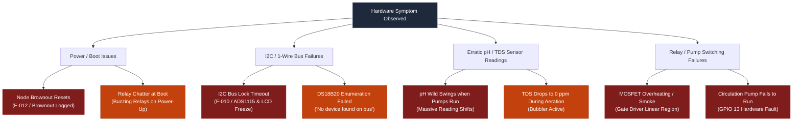

# 🔍 Hardware Troubleshooting & Diagnostic Matrix

This guide provides field technicians and electrical engineers with an exhaustive troubleshooting matrix for diagnosing and resolving electrical faults, bus collisions, sensor anomalies, and power instabilities on the HydroponicsIDF hardware platform.

---

## 1. Master Hardware Diagnostic Decision Tree

---

## 2. Power & Boot Instabilities

### Symptom A: Frequent Hardware Brownout Resets (`SAFETY_FAULT_POWER` / `F-012`)
- **Diagnostic Log**: `Reset reason: ESP_RST_BROWNOUT` or `Brownout detector was triggered`.
- **Root Cause**:
  During Wi-Fi radio calibration and packet transmission bursts, the ESP32-S3 draws instantaneous current pulses exceeding **$500\text{ mA}$ for a few microseconds**. If the $3.3\text{V}$ LDO regulator has insufficient bulk capacitance or high equivalent series resistance (ESR), the internal rail sags below the $2.80\text{V}$ silicon threshold, triggering the internal analog brownout comparator.
- **Remediation**:
  1. Add a **$22\ \mu\text{F}\ 10\text{V X5R/X7R ceramic capacitor}$** in parallel with a **$100\ \mu\text{F}\ 6.3\text{V low-ESR tantalum capacitor}$** directly across the $3.3\text{V}$ and GND pins of the ESP32-S3 module.
  2. Confirm the main $12\text{V}$ DC power supply is rated for at least **$5.0\text{A}$**. Weak 12V adapters sag when multiple peristaltic pumps switch on simultaneously.

### Symptom B: Relays Chatter (Buzz) for 0.5 Seconds During Power-Up
- **Root Cause**:
  The active-HIGH MOSFET gates or optocoupler inputs are missing hardware pull-down resistors, causing them to float into the linear conduction region before `actuator_control_early_gpio_init()` can execute.
- **Remediation**:
  Solder a **$10\text{ k}\Omega$ pull-down resistor** directly between the gate pin of each MOSFET and circuit GND.

---

## 3. Communication Bus Failures (I2C & 1-Wire)

### Symptom C: I2C Bus Lock Timeout (`SAFETY_FAULT_I2C_BUS` / `F-010`)
- **Diagnostic Log**: `ADS1115 read: I2C bus lock timeout (write phase)` or `ADS1115 not found at 0x48`.
- **Root Cause 1 (I2C Bus Jam)**:
  An I2C slave (either the PCF8574 LCD backpack or ADS1115) was interrupted in the middle of a read cycle (e.g. by a task preemption or reset) and is holding the **SDA data line permanently LOW**, waiting for clock pulses that never arrive.
- **Root Cause 2 (Missing / Weak Pull-Ups)**:
  Relying solely on internal ESP32 pull-ups ($\approx 45\text{ k}\Omega$). On a bus with long display wires, total capacitance exceeds $400\text{ pF}$, making the clock and data rise times too slow for the $100\text{ kHz}$ standard.
- **Remediation**:
  1. Measure voltage on SDA (GPIO 16) and SCL (GPIO 15) with an oscilloscope or DMM. Both must sit at **$3.30\text{V}$** when idle. If SDA is stuck at $0\text{V}$, an I2C slave is holding the bus low.
  2. Implement an **I2C Bus Recovery Clock Sequence**: At boot, before calling `i2c_driver_install()`, configure SCL as an open-drain GPIO output and pulse it **9 consecutive times** to force any stuck slave to release the SDA line.
  3. Verify physical **$4.7\text{ k}\Omega$ pull-up resistors** are soldered to both SDA and SCL connected to $3.3\text{V}$.

---

### Symptom D: DS18B20 1-Wire Sensor Disappears (`No DS18B20 found on 1-Wire bus`)
- **Root Cause**:
  1-Wire timing requires microsecond edges. If the sensor cable exceeds 5 meters, cable capacitance rounds off the falling edge of the reset pulse.
- **Remediation**:
  1. For sensor cable runs between 5 and 20 meters, decrease the pull-up resistor from $4.7\text{ k}\Omega$ to **$2.2\text{ k}\Omega$** to sharpen the rising edge.
  2. Confirm the sensor is wired in **Active Power Mode** ($V_{\text{DD}}$ connected to 3.3V, GND to GND, DQ to GPIO 8). **Never use Parasite Power Mode** in commercial automation; the 12-bit conversion will fail without dedicated active strong pull-up transistors.

---

## 4. Analog & Chemical Instrumentation Anomalies

### Symptom E: pH Readings Jump by 0.5 – 1.5 Units Whenever Water Pumps Run
- **Root Cause (Solution Ground Loop)**:
  Submersible AC pumps or unisolated DC motors introduce stray leakage currents into the nutrient water. Because the pH reference electrode is in direct electrolytic contact with the water, this stray potential shifts the virtual ground reference of the BNC connector, creating massive false offsets.
- **Diagnostic Proof**:
  Scoop a cup of water out of the reservoir and immerse the pH probe into the isolated cup on a plastic bench. If the pH reading immediately stabilizes and reads accurately, **a ground loop exists in the main reservoir**.
- **Remediation**:
  1. Install an **isolated DC-DC converter (Mornsun B0505S-1WR3)** and digital I2C bus isolator (**Silicon Labs Si8600 or Analog Devices ADuM1250**) dedicated to the ADS1115 ADC.
  2. Install a **Titanium Solution Ground Probe** connected directly to earth ground in the reservoir to sink stray pump currents safely.

---

### Symptom F: TDS Readings Drop to Zero or Fluctuate Wildly During Aeration
- **Root Cause**:
  Aeration air stones release dense clouds of micro-bubbles. When air bubbles adhere to the two metal pins of the conductivity probe, air (which has near-infinite resistance) displaces the conductive nutrient solution.
- **Remediation**:
  1. Mount the TDS probe at a **$45^\circ$ downward angle** relative to water flow. Air bubbles will naturally slide off the electrode pins.
  2. Move the TDS probe upstream into a quiet, bubble-free sampling chamber or baffle box away from aeration stones.

---

## 5. Actuator & Switching Failures

### Symptom G: N-Channel MOSFET Overheating or Burning Out
- **Root Cause 1 (Non-Logic-Level Gate)**:
  Using an industrial power MOSFET intended for 10V gate drive (e.g. IRF540N). When driven by $3.3\text{V}$ logic from the ESP32-S3, the MOSFET operates in its **linear saturation region**, with an internal resistance of several ohms instead of milliohms. Dissipating $P = I^2 R$, it overheats rapidly.
- **Root Cause 2 (Missing Flyback Diode)**:
  When switching 12V peristaltic motors without a flyback diode, inductive back-EMF spikes of $150\text{V}$ destroy the MOSFET's silicon drain-source oxide layer within days.
- **Remediation**:
  1. Use only **Logic-Level Gate N-MOSFETs** with full channel saturation at $V_{\text{GS}} \le 2.5\text{V}$ (e.g. **Alpha & Omega AO3400A**, **Infineon IRLML6344TRPBF**, or **Vishay SI2302CDS**).
  2. Verify an **SS14 Schottky diode** is soldered directly across the load terminals with the cathode (band) connected to $+12\text{V}$ and anode connected to the MOSFET drain.

