# 🌿 HydroponicsIDF Firmware — Technical Documentation Vault

Welcome to the engineering and architectural documentation vault for the **HydroponicsIDF** firmware. This firmware is a production-grade, safety-critical, FreeRTOS-based control system implemented in C on the **Espressif ESP32-S3** microcontroller using the official **ESP-IDF (v5.x)** framework.

The system is designed for fully autonomous commercial hydroponics zones (e.g. NFT, Dutch Bucket, or Deep Water Culture), performing continuous environmental monitoring, multi-point chemical dosing, closed-loop safety supervision, fault containment, local display marquee diagnostics, and bidirectional MQTT telemetry/command bridging with HTTP Over-The-Air (OTA) upgradeability.

---

## 🗺️ Documentation Map of Content (MOC)

```mermaid
graph TD
    Home["🌿 Vault Index (Home)"] --> Arch["01 - Architecture"]
    Home --> Subs["02 - Subsystems & Tasks"]
    Home --> Ref["03 - Reference & Specs"]
    Home --> Def["04 - Defense & Engineering Q&A"]
    Home --> Aud["05 - Audit (Criticism & Bugs)"]
    Home --> Dev["06 - Device & PCB Guide"]

    Arch --> A1["[[System Architecture & FreeRTOS]]"]
    Arch --> A2["[[Boot Sequence & Power Recovery]]"]

    Subs --> S1["[[Safety Subsystem & Watchdogs]]"]
    Subs --> S2["[[Dosing & Actuator Control]]"]
    Subs --> S3["[[Sensor Telemetry & Calibration]]"]
    Subs --> S4["[[Networking & MQTT Engine]]"]
    Subs --> S5["[[Web Portal, OTA & Provisioning]]"]
    Subs --> S6["[[Human-Machine Interfaces & Diagnostics]]"]

    Ref --> R1["[[Pin & Hardware Mapping Matrix]]"]
    Ref --> R2["[[MQTT Protocol Specification]]"]
    Ref --> R3["[[Safety Faults & Parameter Catalog]]"]

    Def --> D1["[[Technical Defense & Architecture Q&A]]"]

    Aud --> AU0["[[00 - Executive Summary & Risk Matrix]]"]
    Aud --> AU1["[[01 - Critical Safety Vulnerabilities & Timing Hazards]]"]
    Aud --> AU2["[[02 - Spaghetti Architecture & Code Smells]]"]
    Aud --> AU3["[[03 - Networking, OTA & Cybersecurity Vulnerabilities]]"]
    Aud --> AU4["[[04 - Sensor & Actuator Physics Critique]]"]
    Aud --> AU5["[[05 - Refactoring Roadmap & Remediation Plan]]"]

    Dev --> DEV0["[[00 - Hardware Architecture & System Topology]]"]
    Dev --> DEV1["[[01 - Schematic & Circuit Design Guide]]"]
    Dev --> DEV2["[[02 - PCB Layout & EMC Guidelines]]"]
    Dev --> DEV3["[[03 - Enclosure & Environmental Protection (IP65)]]"]
    Dev --> DEV4["[[04 - Assembly, Bring-Up & Field Commissioning]]"]
    Dev --> DEV5["[[05 - Hardware Troubleshooting Matrix]]"]

    style Home fill:#0f766e,stroke:#115e59,stroke-width:2px,color:#fff
    style Arch fill:#1e293b,stroke:#334155,stroke-width:1px,color:#fff
    style Subs fill:#1e293b,stroke:#334155,stroke-width:1px,color:#fff
    style Ref fill:#1e293b,stroke:#334155,stroke-width:1px,color:#fff
    style Def fill:#1e293b,stroke:#334155,stroke-width:1px,color:#fff
    style Aud fill:#7f1d1d,stroke:#991b1b,stroke-width:2px,color:#fff
    style Dev fill:#1e3a8a,stroke:#1e40af,stroke-width:2px,color:#fff
```

### 1. System Architecture & Core Primitives
- **[[System Architecture & FreeRTOS]]**
  * FreeRTOS Task Matrix: Priority scheduling, stack budgeting, intervals, and CPU affinity.
  * Concurrency and Synchronization Primitives: Lock-free atomic variables (`<stdatomic.h>`), critical sections (`portMUX_TYPE`), non-blocking queues, and mutex hierarchies.
  * Memory footprint and partition layout (`nvs`, `otadata`, `factory`, `ota_0`, `ota_1`).
  * Anti-priority-inversion design principles.
- **[[Boot Sequence & Power Recovery]]**
  * Hardware bootloader execution to `app_main`.
  * Early GPIO clamping to prevent relay contact chatter.
  * Reset reason triage (`esp_reset_reason()`) and non-volatile boot-fault recording.
  * Headless autostart state machine, the persistent `wifi_tries` failure loop, and fallback to the captive Web Setup Portal via physical button monitor (GPIO 46).

### 2. Subsystems & Tasks
- **[[Safety Subsystem & Watchdogs]]**
  * `SafetyTask` (Priority 4) execution via FreeRTOS Task Notifications (`ulTaskNotifyTake`).
  * Two-tier watchdog architecture: Software Task Heartbeats + Hardware Task Watchdog Timer (`esp_task_wdt`).
  * Peristaltic mutual exclusion / chemical hazard interlock (pH Up vs. pH Down simultaneous dosing prohibition).
  * Out-of-bounds, rate-of-change, and frozen sensor anomaly detection.
  * Dosing response timers (pH 90s, TDS 120s) and main water valve fill timeout (10 min).
  * Safe Mode state transition mechanics: asynchronous GPIO shutdown, queue draining without kernel panics, and clearing protocol (`CLEAR`, `ALL`, `MASK:<hex>`).
- **[[Dosing & Actuator Control]]**
  * `DosingTask` (Priority 3) event-driven execution with 64-depth FreeRTOS command queue.
  * Actuator Channel Matrix: Solenoid water valve, 4 peristaltic pumps (Nutrient A, Nutrient B, pH Up, pH Down), 4 generic AC/DC relays, and the **Circulation Pump**.
  * The **Perpetual Circulation Pump Protection Principle**: GPIO 13 driven HIGH at boot and immune to stop/safe-mode commands.
  * Command actions: `ON`, `OFF`, and atomic hardware `PULSE:<ms>`.
  * Queue full policy: "Latest-Wins" queue flush & overwrite.
- **[[Sensor Telemetry & Calibration]]**
  * `SensorTask` (Priority 2, 2000 ms jitter-free sampling via `vTaskDelayUntil`).
  * Multi-sensor acquisition pipeline: ADS1115 16-bit I2C ADC, DS18B20 1-Wire temperature, GY-SHT31 environment sensor, and digital float switch.
  * Digital water level dual-phase software debounce filter.
  * TDS real-time temperature compensation normalized to 25°C.
  * Dual-mode pH acquisition: High-speed UART serial module vs. ADS1115 analog input with median filtering.
  * Real-time Vapor Pressure Deficit (VPD) computation from SHT31 humidity and room temperature.
  * Dynamic two-point linear calibration protocol with NVS persistence, retry loops, and read-back verification.
- **[[Networking & MQTT Engine]]**
  * `CommTask` (Priority 1, 3000 ms periodic telemetry publisher).
  * Thread-safe snapshot acquisition with last-known-good cache fallback.
  * `mqtt_manager`: Zero-wildcard exact topic dispatch engine, re-entrant callback protection, and auto-resubscription tables upon reconnect.
  * Wi-Fi AP+STA (APSTA) dual-interface state machine, timeout retries, and network reconnection hooks.
- **[[Web Portal, OTA & Provisioning]]**
  * Local captive portal HTTP server (`esp_http_server`) serving responsive setup form on `192.168.4.1`.
  * Hardware setup button monitor: 3-second physical hold on GPIO 46 to trigger soft-AP mode.
  * Non-volatile configuration profiles (`setup_cfg`, `zone_cfg`, `storage`).
  * Asynchronous HTTP Over-The-Air (OTA) firmware upgrade engine with partition boundary checks and rollback protection.
- **[[Human-Machine Interfaces & Diagnostics]]**
  * 20x4 Character LCD (`PCF8574` I2C backpack) with shared I2C bus mutex arbitration (`i2c_bus_lock`).
  * Asynchronous marquee scroll task (`lcd_scroll_task_fn`) for displaying long JSON error codes and diagnostic messages.
  * Status indicator LEDs: Connection LED (GPIO 1), Fault LED (GPIO 2) with non-blocking blink queue, and startup buzzer signals.
  * Syslog UDP broadcast engine (port 514).

### 3. Reference & Protocol Specifications
- **[[Pin & Hardware Mapping Matrix]]**
  * Complete GPIO mapping, electrical definitions, pull-up/down resistors, bus frequencies, and jumper options.
- **[[MQTT Protocol Specification]]**
  * Exhaustive reference table of all inbound/outbound MQTT topics, QoS levels, retain flags, and JSON payloads.
- **[[Safety Faults & Parameter Catalog]]**
  * Catalog of all fault codes (`F-001` through `F-013`), bitmasks, detection logic, hardware actions, and configurable threshold macros.

### 4. Academic & Defense Guide
- **[[Technical Defense & Architecture Q&A]]**
  * Comprehensive oral exam and technical defense guide synthesized from `sidang.md` and codebase analysis, detailing real-time systems rationale, priority inversion prevention, relay chatter avoidance, race condition mitigations, and design trade-offs.

### 5. Adversarial Audit, Security & Spaghetti Code Critique
- **[[00 - Executive Summary & Risk Matrix]]**
  * Master vulnerability catalog, CVSS scores, and industrial risk matrix (IEC 61508 / ISO 13849).
- **[[01 - Critical Safety Vulnerabilities & Timing Hazards]]**
  * The 60-second blocking pulse watchdog panic trap, SMP `xQueueReset` race condition, and single-point-of-failure software interlocks.
- **[[02 - Spaghetti Architecture & Code Smells]]**
  * The 1,870-line `sensor_telemetry.c` God-file, brittle hand-rolled JSON substring matching, deceptive pin header discrepancies, and redundant state duplication.
- **[[03 - Networking, OTA & Cybersecurity Vulnerabilities]]**
  * Plaintext unsigned HTTP OTA (RCE exploit), open Wi-Fi Soft-AP, unauthenticated web captive portal, and NVS flash endurance exhaustion DoS.
- **[[04 - Sensor & Actuator Physics Critique]]**
  * 16-bit ADC illusions vs analog ground loop noise, 2-point linear calibration model breakdown at high ppm, float slosh blind spots, and dry-run pump burnout.
- **[[05 - Refactoring Roadmap & Remediation Plan]]**
  * Actionable, production-ready C code patches for non-blocking pulse timers, thread-safe queue drains, `cJSON` parsing, and driver decoupling.

### 6. Embedded Device, PCB Design & Field Usage Guide
- **[[00 - Hardware Architecture & System Topology]]**
  * Master hardware block diagram, multi-rail power tree, and galvanic isolation boundaries.
- **[[01 - Schematic & Circuit Design Guide]]**
  * Low-side MOSFET drivers, flyback protection, electromechanical break-before-make interlock, and ultra-high-impedance pH op-amp circuits.
- **[[02 - PCB Layout & EMC Guidelines]]**
  * 4-layer stackup, 3-zone board partitioning, 6.3mm AC creepage isolation slots, and BNC guard rings.
- **[[03 - Enclosure & Environmental Protection (IP65)]]**
  * Polycarbonate vs ABS UV resistance, cable gland drip loops, and ePTFE hydrophobic condensation breather vents.
- **[[04 - Assembly, Bring-Up & Field Commissioning]]**
  * Ultrasonic flux decontamination, unpowered cold board testing, strapping pin checks, and 2-point buffer calibration SOPs.
- **[[05 - Hardware Troubleshooting Matrix]]**
  * Diagnostic decision tree for I2C bus lockups, 1-Wire discovery failures, ground loops, and MOSFET saturation failures.

---

## ⚡ Quick Technical Specifications

| Parameter | Specification |
|---|---|
| **Target MCU** | Espressif ESP32-S3 (Dual-Core Xtensa LX7 @ 240 MHz, 512 KB SRAM) |
| **Framework** | ESP-IDF (C99 / FreeRTOS SMP) |
| **Flash Partitioning** | 16 KB NVS, 8 KB OTA Data, 1536 KB Factory, 2x 1536 KB OTA App Slots |
| **Network Interfaces** | Wi-Fi 802.11 b/g/n (APSTA: SoftAP + Station) |
| **Protocols** | MQTT (v3.1.1), HTTP 1.1 (Server & Client for OTA), UDP Syslog |
| **External ADCs** | Texas Instruments ADS1115 (16-bit Delta-Sigma, I2C address 0x48) |
| **Bus Topologies** | Shared I2C0 (LCD 20x4 + ADS1115 + SHT31 @ 100 kHz), 1-Wire (DS18B20 via RMT), UART1 (pH Serial Module @ 115200 bps) |
| **Safety Tasks** | 4 Preemptive FreeRTOS Tasks with Hardware & Software Watchdogs |
| **Actuator Outputs** | 10 Channels (5 Peristaltic/Valve Outputs + 4 Relays + 1 Protected Circulation Pump) |

---
> [!TIP]
> Navigate to **[[Home]]** or any linked page above using Obsidian's internal graph or note preview. All references link directly to source code symbols and configuration definitions in the firmware repository.
